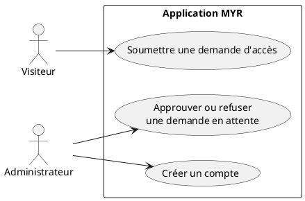
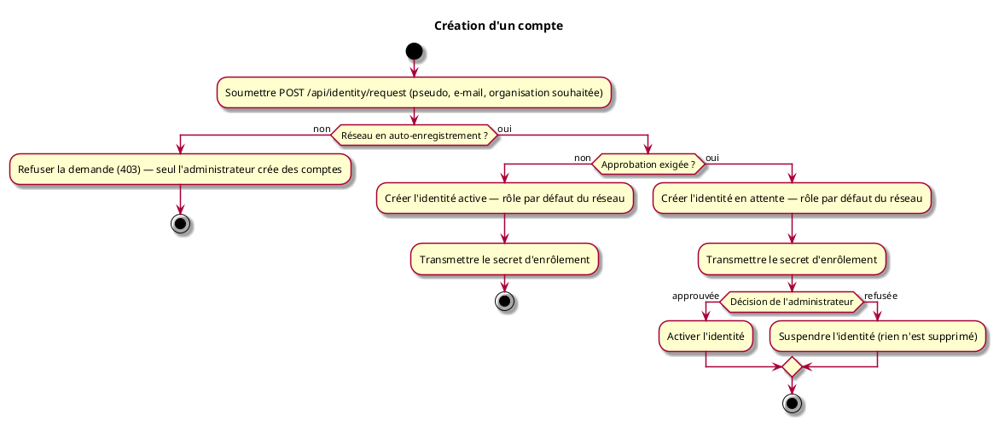

# Création d'un compte

## Diagramme d'acteurs

## Contexte

Il n'y a pas de compte email + mot de passe : l'identité est une paire de clés cryptographiques enregistrée auprès de l'autorité de certification (CA) du réseau blockchain. « Créer un compte » signifie obtenir un **secret d'enrôlement** valide pour un pseudo donné. Le statut de l'identité (active, en attente, suspendue) et son rôle sont inscrits dans le certificat qu'elle reçoit à chaque connexion (voir UCA02).

Les règles d'inscription sont propres à chaque réseau et fixées par son administrateur :

1. **Réseau fermé à l'auto-enregistrement** : aucune demande d'accès n'est acceptée. Seul l'administrateur crée des comptes, actifs d'emblée avec le rôle qu'il choisit, et transmet le secret d'enrôlement à l'utilisateur par un autre canal.
2. **Auto-enregistrement sans approbation** : la demande crée immédiatement une identité active, avec le rôle par défaut défini par l'administrateur pour ce réseau (**Lecteur** s'il n'en a pas défini d'autre). Le secret d'enrôlement est retourné directement.
3. **Auto-enregistrement avec approbation** : la demande crée immédiatement l'identité avec le rôle par défaut, mais **en attente** ; le secret d'enrôlement est retourné, mais l'identité ne peut pas se connecter tant que l'administrateur ne l'a pas approuvée. Un refus suspend l'identité — rien n'est supprimé.

Pour obtenir un rôle supplémentaire (Concepteur, Consommateur…), une action de l'administrateur reste nécessaire — voir UCA08.

**Sur la portée réelle de l'auto-enregistrement :** ce mécanisme supprime la validation humaine *au moment de la demande* — aucun administrateur n'intervient avant la création de l'identité, même lorsque son activation reste soumise à approbation. Il ne supprime pas pour autant toute autorité d'enregistrement : la CA du réseau exige qu'une identité **registrar**, dotée des privilèges d'enregistrement, signe chaque nouvelle identité créée. Cette identité registrar est provisionnée une seule fois, à la création du réseau, puis utilisée de façon automatisée par l'application pour chaque demande — ce n'est donc pas une création de compte totalement décentralisée (comme une génération de clé locale sans aucune autorité), mais une automatisation du rôle d'autorité d'enregistrement (voir `specs/3-Conception/Conception_intro.md` ADR-07 pour la décision d'architecture, ADR-12 pour les règles d'inscription).

#incoherence chaque création de compte doit etre accessible indépendamment du noeud. Car l'interet est d'éviter la perte de donnée ou des accès si un serveur est HS. 

#remarque Si l'administrateur l'y autorise, une lecture sans compte doit pouvoir etre possible (comme un accès aux produits d'un site)

## Pré-conditions

- Réseau existant et accessible
- Règles d'inscription du réseau fixées par l'administrateur (`myr network add` / `myr network update` : `--auto-register`, `--require-approval`, `--auto-role`)

## Scénario

**Étape initiale :** Un client (interface graphique tierce, script, plugin...) soumet une demande d'accès via `POST /api/identity/request` — ou, pour le compte d'un utilisateur, un administrateur exécute la commande CLI équivalente (`myr identity request --pseudo 
 --email <e> --org-id <id>`)

### Flux nominal — Auto-enregistrement sans approbation

1. Le pseudo, l'e-mail et l'organisation souhaitée sont transmis (`POST /api/identity/request` — pseudo, email, org_id)
2. Le réseau autorise l'auto-enregistrement sans approbation : l'identité est créée active, avec le rôle par défaut du réseau
3. Un secret d'enrôlement est retourné dans la réponse (statut de la demande : approuvée)
4. Ce secret permet de se connecter immédiatement (voir UCA02)

### Flux alternatif — Auto-enregistrement avec approbation

1. Étapes 1 et 2 identiques, mais le réseau exige une approbation : l'identité est créée **en attente**
2. Un secret d'enrôlement est retourné (statut de la demande : en attente) ; une connexion avec ce secret est refusée tant que l'identité n'est pas approuvée
3. L'administrateur consulte les demandes (`GET /api/identity/requests` ou `myr identity requests`)
4. Il approuve la demande (`POST /api/identity/requests/{id}/approve` ou `myr identity approve <id>`) : l'identité devient active
5. L'utilisateur se connecte avec le secret reçu à l'étape 2 (voir UCA02)

### Flux alternatif — Demande refusée par l'administrateur

1. Étapes 1 à 3 du flux précédent
2. L'administrateur refuse la demande (`POST /api/identity/requests/{id}/reject` ou `myr identity reject <id>`) : l'identité est **suspendue** — elle ne peut ni se connecter ni écrire
3. Rien n'est supprimé : l'identité et la demande restent consultables

### Flux alternatif — Création de compte par l'administrateur

1. L'administrateur crée le compte (`POST /api/identity/accounts` ou `myr identity register --pseudo 
 --org-id <id> --role <r>`) — c'est la seule voie d'inscription sur un réseau fermé à l'auto-enregistrement
2. L'identité est créée active avec le rôle choisi ; le secret d'enrôlement est retourné à l'administrateur, qui le transmet à l'utilisateur par un autre canal

### Flux erreur — Réseau fermé à l'auto-enregistrement

1. Une demande d'accès est soumise alors que le réseau n'accepte pas l'auto-enregistrement (ou qu'aucun réseau actif n'est configuré)
2. La demande est refusée (`403 Forbidden`) et rien n'est conservé — l'utilisateur doit s'adresser à l'administrateur

### Flux erreur — Décision sur une demande qui n'est plus en attente

1. L'administrateur approuve ou refuse une demande déjà décidée : refus (`409 Conflict`), l'identité n'est pas modifiée
2. Une demande inconnue est signalée (`404 Not Found`)

## Post-conditions

- Sur un réseau ouvert : une demande d'accès existe (approuvée, en attente ou refusée) et l'identité correspondante existe auprès de la CA, active, en attente ou suspendue
- Sur création par l'administrateur : une identité active existe avec le rôle choisi
- Dans tous les cas où une identité est créée, l'utilisateur dispose d'un secret d'enrôlement ; seule une identité active peut s'en servir pour se connecter

> **Note architecture :** Il n'existe pas d'étape séparée de « provisionnement de l'identité blockchain » — l'identité *est* le compte, et se connecter (UCA02) *est* l'action qui l'enrôle auprès de la CA. C'est aussi ce qui rend l'approbation effective : le certificat émis à la connexion suivante porte le nouveau statut.

## Diagramme d'activités

<!-- liens-obsidian:begin — section de traçabilité générée à partir des références du document : ne pas l'éditer à la main -->
## Liens

**Étape suivante — analyse**
- [UCA01 — analyse](../../2-Analyse/UCA-Compte_et_Acces/UCA01.md)

<!-- liens-obsidian:end -->
