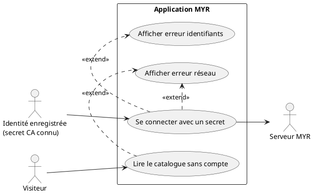
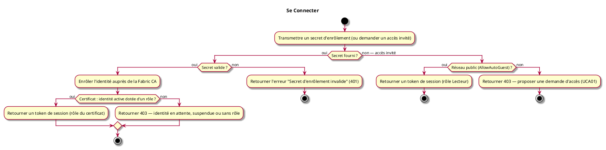

# Se Connecter

## Diagramme d'acteurs

## Contexte

Il n'y a pas de formulaire email / mot de passe. « Se connecter » consiste à fournir le **secret d'enrôlement** délivré par un administrateur (voir UCA01) : le serveur enrôle (ou ré-enrôle) l'identité auprès de la Fabric CA du réseau, puis ouvre une session identifiée par un **token opaque** (pas un JWT).

Il n'y a pas d'étape de « provisionnement de l'identité blockchain » distincte de la connexion : enrôler l'identité auprès de la CA *est* l'action de connexion elle-même. Il n'existe donc pas de flux séparé « première connexion » vs « connexion standard » — le même appel (`POST /api/identity/session`) couvre les deux cas.

Le certificat émis à la connexion est la seule source de vérité de l'accès : il porte le **statut** de l'identité (active, en attente d'approbation, suspendue) et son **rôle**. Seule une identité active dotée d'un rôle ouvre une session, et la session porte exactement ce rôle. Une approbation, un refus ou un changement de rôle décidés par l'administrateur (UCA01, UCA08) prennent donc effet à la connexion suivante.

Un visiteur sans compte n'ouvre aucune session : si l'administrateur a ouvert la lecture publique du réseau, il lit le catalogue publié sans jeton (RM49). Toute écriture exige une connexion avec secret.

## Pré-conditions

- Pour une connexion avec secret : une identité a été enregistrée auprès de la CA (UCA01), et son secret d'enrôlement est connu
- Pour une lecture sans compte : le réseau MYR visé existe et est accessible

## Scénario

**Étape initiale :** Un client transmet le secret reçu de l'administrateur via `POST /api/identity/session`

### Flux nominal — Connexion avec secret

1. Le pseudo, le secret d'enrôlement et l'organisation sont transmis (`POST /api/identity/session`)
2. Le serveur (ré-)enrôle l'identité auprès de la Fabric CA du réseau
3. Le certificat émis indique une identité active dotée d'un rôle
4. Un token de session est retourné dans la réponse, associé au rôle inscrit dans le certificat
5. Le client inclut ce token dans l'en-tête `X-Myr-Token` pour les requêtes suivantes

### Flux alternatif — Lecture sans compte (lecture publique ouverte)

1. Le client lit la politique du réseau (`GET /api/identity/policy`, champ `allow_auto_guest`)
2. L'administrateur a ouvert la lecture publique
3. Le client lit le catalogue publié sans jeton ni session (RM49) — aucun enrôlement CA n'a lieu

### Flux alternatif — Lecture publique fermée (réseau privé)

1. L'administrateur n'a pas ouvert la lecture publique : une lecture sans jeton est refusée (`401`)
2. Une demande d'accès peut être soumise (voir UCA01)

### Flux erreur — Secret invalide

1. Le serveur retourne une erreur d'enrôlement (`401 Unauthorized`)
2. Message d'erreur : « Secret d'enrôlement invalide »
3. Une nouvelle tentative peut être soumise avec un secret corrigé

### Flux erreur — Identité inactive ou sans rôle

1. Le secret est valide, mais le certificat émis indique une identité en attente d'approbation, suspendue, sans statut reconnu, ou sans rôle
2. Aucune session n'est ouverte (`403 Forbidden`) ; le message indique la cause (approbation attendue, identité suspendue, rôle absent)
3. Une identité en attente pourra se connecter dès que l'administrateur l'aura approuvée (UCA01)

### Flux erreur — Serveur inaccessible

1. La requête échoue (timeout ou erreur réseau)
2. Le client reçoit une erreur de connexion et doit réessayer

## Post-conditions

- L'utilisateur dispose d'un token de session valide (7 jours) associé à un rôle
- L'accès aux fonctionnalités est accordé selon ce rôle

## Diagramme d'activités

<!-- liens-obsidian:begin — section de traçabilité générée à partir des références du document : ne pas l'éditer à la main -->
## Liens

**Étape suivante — analyse**
- [UCA02 — analyse](../../2-Analyse/UCA-Compte_et_Acces/UCA02.md)

<!-- liens-obsidian:end -->
