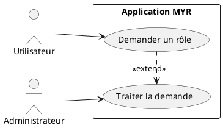
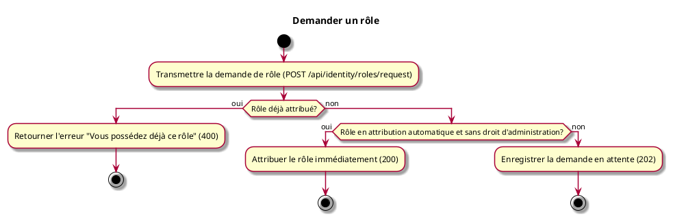

# Demander un rôle

## Diagramme d'acteurs

## Contexte

Un utilisateur connecté (rôle Lecteur ou autre) peut demander un autre rôle de la table des rôles du réseau. Chaque rôle de cette table est réglé par l'administrateur en attribution automatique ou sur approbation : la demande est traitée automatiquement dans le premier cas, soumise à l'administrateur dans le second. Un rôle portant un droit d'administration n'est jamais attribué automatiquement (RM47). Le nouveau rôle prend effet à la prochaine connexion de l'utilisateur.

## Pré-conditions

- Être connecté, avec une identité active
- Rôle cible présent dans la table des rôles (RM46) et différent du rôle déjà détenu
- Aucune autre demande de rôle de l'utilisateur en attente

## Scénario

**Étape initiale :** Le client transmet une demande de rôle pour l'identité connectée (`POST /api/identity/roles/request` — rôle souhaité ; en CLI, `myr identity request-role <rôle>` pour l'identité du compte local)

### Flux nominal — Attribution automatique

1. Le rôle souhaité est transmis
2. Le rôle cible est en attribution automatique dans la table des rôles du réseau
3. Le rôle est attribué immédiatement (`200 OK`) — la réponse indique le rôle attribué, actif à la prochaine connexion

### Flux alternatif — Validation manuelle par l'administrateur

1. Le rôle souhaité est transmis
2. Le rôle cible est sur approbation, ou porte un droit d'administration
3. La demande est enregistrée en attente (`202 Accepted`)
4. Le rôle courant est conservé jusqu'à la décision de l'administrateur (`myr identity approve|reject`) : approuvée, le rôle est attribué ; refusée, l'utilisateur garde son rôle (RM44)

### Flux erreur — Rôle déjà attribué

1. Le rôle demandé est déjà détenu par l'identité
2. Réponse d'erreur : « Vous possédez déjà ce rôle » (`400 Bad Request`)

### Flux erreur — Rôle inconnu ou demande déjà en attente

1. Le rôle demandé n'existe pas dans la table des rôles : refusé (`400 Bad Request`, RM46)
2. Une autre demande de rôle de l'utilisateur attend déjà la décision de l'administrateur : refusée (`409 Conflict`)

## Post-conditions

- Rôle attribué immédiatement (attribution automatique), ou demande en attente de l'approbation de l'administrateur ; dans les deux cas, le nouveau rôle prend effet à la prochaine connexion

## Diagramme d'activités

<!-- liens-obsidian:begin — section de traçabilité générée à partir des références du document : ne pas l'éditer à la main -->
## Liens

**Étape suivante — analyse**
- [UCA08 — analyse](../../2-Analyse/UCA-Compte_et_Acces/UCA08.md)

<!-- liens-obsidian:end -->
