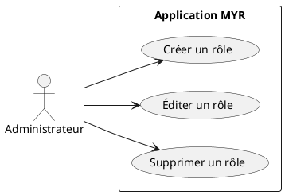
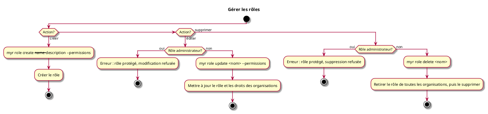

# Gérer les rôles

## Diagramme d'acteurs

## Contexte

L'administrateur gère les définitions de rôles disponibles sur le réseau. Un rôle regroupe un ensemble de droits et d'accès qui peuvent ensuite être attribués à des organisations (voir UCADM06).

Le rôle administrateur est natif au système : il ne peut pas être modifié ni supprimé, et porte toujours tous les droits.

La table des rôles est publiée sur le ledger, un exemplaire par canal du réseau, et appliquée à l'identique par tous les nœuds (RM48). Tant que l'administrateur n'en a publié aucune, la table initiale s'applique (`reader`, `contributor`, `auditor`, `admin`) ; ses rôles se modifient et se suppriment comme les autres, sauf `admin`. Chaque rôle porte aussi un réglage d'attribution sur demande : automatique, ou sur approbation de l'administrateur (UCA08, RM47).

#incoherence Ce use case attribue les rôles aux organisations (UCADM06), alors que l'ADR-12 porte le rôle dans le certificat de chaque identité (`Myr.role`, attribué par `myr identity register|set-role` ou une demande de rôle, UCA08). La table des rôles ne comporte pas non plus de description. À trancher : attribution par organisation, par identité, ou les deux.

## Pré-conditions

- Être connecté en tant qu'administrateur du réseau

## Scénario

**Étape initiale :** Sur le serveur (SSH), l'administrateur exécute une commande `myr role` (équivalent REST via le service domaine `role`)

### Flux nominal — Rôle créé

1. `myr role create <nom> --permission <droit> [--permission <droit>…] [--auto-grant]` est exécutée
2. Le rôle est ajouté à la table avec la liste des droits accordés et son réglage d'attribution, puis la table est publiée sur le ledger
3. Le rôle est disponible pour attribution aux organisations (UCADM06)

### Flux nominal — Rôle édité

1. `myr role update <nom> [--permission <droit>…] [--auto-grant=true|false]` est exécutée sur un rôle existant (autre que le rôle administrateur)
2. Les droits accordés ou le réglage d'attribution sont mis à jour, puis la table est publiée sur le ledger
3. Les organisations possédant ce rôle bénéficient immédiatement des droits mis à jour

### Flux nominal — Rôle supprimé

1. `myr role delete <nom>` est exécutée sur un rôle existant (autre que le rôle administrateur)
2. Le rôle est retiré de la table, puis la table est publiée sur le ledger ; une identité qui le porte encore n'a plus aucun droit

### Flux erreur — Tentative de modification du rôle administrateur

1. Une commande d'édition ou de suppression cible le rôle administrateur
2. Le système refuse l'opération
3. Message : `Le rôle administrateur est protégé et ne peut pas être modifié ni supprimé.`

## Post-conditions

- **Création :** le nouveau rôle est disponible pour attribution (UCADM06)
- **Édition :** les organisations possédant ce rôle ont leurs droits mis à jour
- **Suppression :** le rôle est dissocié de toutes les organisations et supprimé du système

## Diagramme d'activités

<!-- liens-obsidian:begin — section de traçabilité générée à partir des références du document : ne pas l'éditer à la main -->
## Liens

**Étape suivante — analyse**
- [UCADM07 — analyse](../../2-Analyse/UCADM-Administration/UCADM07.md)

<!-- liens-obsidian:end -->
