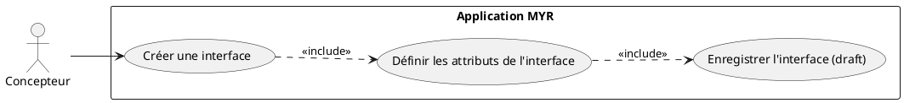
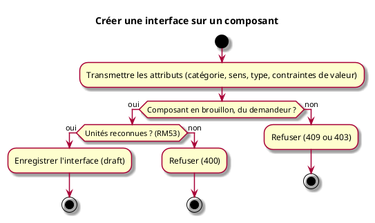

---
tags:
  - rm/RM19
  - rm/RM53
  - rm/RM54
---
---
categorie: Assemblage Module
titre: "Créer une interface sur un composant"
probabilite: 3
impact: 5
importance: 15
etat: relu
tags:
  - couche/expression
  - type/use-case
  - famille/UCAM
  - domaine/model
  - uc/UCAM03
---
# Créer une interface sur un composant

## Diagramme d'acteurs

## Contexte

Une interface est un point de connexion d'un composant. Elle est toujours créée explicitement, avec ses attributs : catégorie, sens, type et contraintes de valeur (RM53). Le système ne déduit aucun attribut d'une autre interface : un outil client peut proposer des valeurs à son utilisateur, mais c'est la demande qui les porte.

## Pré-conditions

- Être connecté au réseau
- Avoir un composant en brouillon dont on est le propriétaire (RM54)
- Avoir les droits de création ou d'édition sur le composant (défini dans le rôle)

## Scénario

**Étape initiale :** `myr model interface add <assetID> --category <cat> --type <type> --direction <in|out|bidir> [--value-min <v> --value-max <v> --unit <u>] [--name <label>]` est exécutée (ou `POST /api/components/{id}/interfaces`)

### Flux nominal — Interface créée

1. Les attributs de l'interface sont transmis
2. L'interface est enregistrée sur le composant, à l'état brouillon
3. Elle peut ensuite être reliée à une interface compatible d'un autre composant (UCAM01)

### Flux erreur — Unité inconnue

1. Une contrainte porte une unité inconnue, même après lecture d'un préfixe SI usuel (RM53)
2. L'interface est refusée (API : 400)

### Flux erreur — Composant soumis ou d'une autre identité

1. Le composant est déjà soumis (RM19, API : 409) ou appartient à une autre identité (RM54, API : 403)
2. L'interface est refusée ; une interface s'ajoute à un nouvel asset dérivé du composant soumis

## Post-conditions

- La nouvelle interface est enregistrée sur le composant, à l'état brouillon

## Diagramme d'activités

<!-- liens-obsidian:begin — section de traçabilité générée à partir des références du document : ne pas l'éditer à la main -->
## Liens

**Étape suivante — analyse**
- [UCAM03 — analyse](../../2-Analyse/UCAM-Assemblage_Module/UCAM03.md)

<!-- liens-obsidian:end -->
