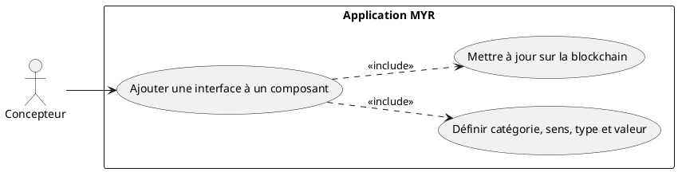
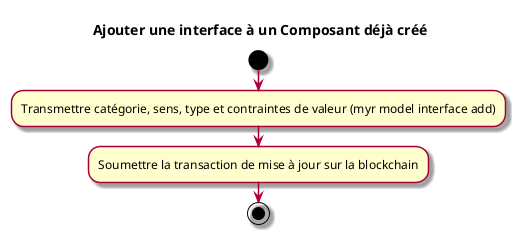

---
tags:
  - rm/RM11
  - rm/RM53
  - relecture/remarque
---
---
categorie: Composant Ecriture
titre: "Ajouter une interface à un Composant déjà créé"
probabilite: 2
impact: 3
importance: 6
etat: relire
tags:
  - couche/expression
  - type/use-case
  - famille/UCCE
  - domaine/model
  - uc/UCCE06
---

# Ajouter une interface à un Composant déjà créé

## Diagramme d'acteurs

## Contexte

Un utilisateur peut ajouter manuellement une interface à un composant qu'il a déjà créé, utile lorsque la détection automatique n'a pas pu être réalisée.

## Pré-conditions

- Être connecté au réseau
- Être propriétaire du composant
- Avoir les droits d'édition

## Scénario

**Étape initiale :** `myr model interface add <assetID> --category MECA --type "vis M6" --direction bidir --value-min 5 --value-max 6 --unit mm` est exécutée (ou l'appel API équivalent), pour le compte du propriétaire du composant

### Flux nominal — Interface ajoutée

1. La catégorie (Électrique, Mécanique, Hydraulique...) est définie
2. Le sens (Entrée, Sortie, Bidirectionnel) est défini
3. Le type (ex : USB-C) est renseigné
4. Zéro, une ou plusieurs contraintes de valeur sont renseignées, chacune avec sa valeur ou sa plage et son unité (ex. 5 V et 0 à 2 A ; RM11, RM53)
5. La transaction de mise à jour est soumise sur la blockchain
6. L'interface devient disponible pour les liaisons (voir UCAM01)

### Flux erreur — Unité inconnue

1. Une contrainte porte une unité absente du vocabulaire des unités, même après lecture d'un préfixe SI usuel (RM53)
2. L'interface est refusée (API : 400) : le système ne devine pas l'unité

#remarque — la syntaxe CLI d'une interface à plusieurs contraintes (l'exemple de l'étape initiale n'en porte qu'une) est à définir dans `DC_CLI_Model.md` lors de la mise en œuvre de FT-042.

## Post-conditions

- L'interface est ajoutée au composant sur le réseau
- Elle est disponible pour les liaisons (voir UCAM01)

## Diagramme d'activités

<!-- liens-obsidian:begin — section de traçabilité générée à partir des références du document : ne pas l'éditer à la main -->
## Liens

**Étape suivante — analyse**
- [UCCE06 — analyse](../../2-Analyse/UCCE-Composant_Ecriture/UCCE06.md)

<!-- liens-obsidian:end -->
