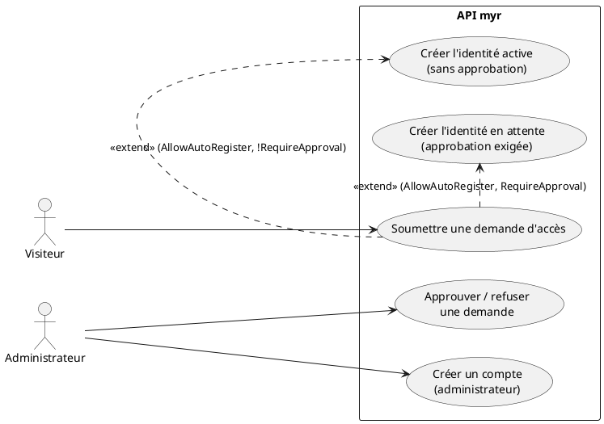
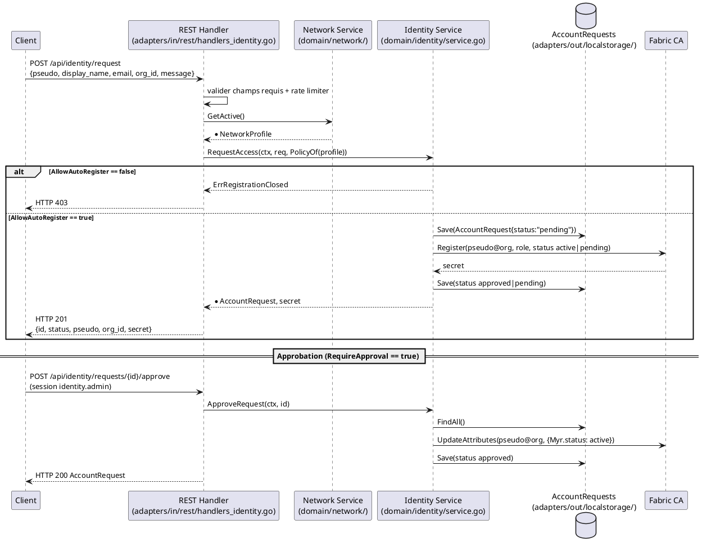

# Création d'un compte

## Diagramme d'acteurs

## Contexte

Il n'existe **pas de compte email + mot de passe** dans `myr`. L'identité d'un utilisateur est une identité cryptographique enregistrée auprès de la Fabric CA du réseau (cf. RM20) : « créer un compte » signifie obtenir un secret d'enrôlement CA valide pour un pseudo donné. L'identifiant CA de l'identité est `pseudo@org` (`identity.Handle`), et son statut et son rôle sont portés par les attributs `Myr.status` et `Myr.role` des certificats émis — seule source de vérité de l'autorisation (ADR-12, `specs/3-Conception/Conception_intro.md` §6).

Les règles d'inscription sont un réglage du profil réseau, fixé par l'administrateur (`domain/network`, `NetworkProfile`) et converties en `identity.RegistrationPolicy` (`identity.PolicyOf`) :

| Réglage réseau | Politique | Effet sur une demande |
|----------------|-----------|------------------------|
| `AllowAutoRegister=false` (ou aucun réseau actif) | fermée | refusée (`ErrRegistrationClosed`), rien n'est conservé — seul l'administrateur crée des comptes (`CreateAccount`) |
| `AllowAutoRegister=true`, `RequireApproval=false` | ouverte | identité créée `Myr.status=active`, demande `approved` |
| `AllowAutoRegister=true`, `RequireApproval=true` | ouverte avec approbation | identité créée `Myr.status=pending`, demande `pending` jusqu'à la décision de l'administrateur |

Le rôle attribué à l'inscription est `AutoRegisterRole` du profil réseau, ou `reader` par défaut (RM21). L'identité est créée dans la CA **dès la demande**, y compris lorsqu'une approbation est exigée : l'approbation ne fait que changer son statut (`CAPort.UpdateAttributes`), elle ne la crée pas. Le changement s'applique au prochain enrôlement, c'est-à-dire à la prochaine connexion (UCA02), qui ré-enrôle systématiquement.

Il existe aussi un accès **invité** sans aucune identité CA (voir UCA02, `POST /api/identity/guest`), qui n'entre pas dans ce use case.

**Sur la portée réelle de l'auto-enregistrement (`AllowAutoRegister=true`) :** ce réglage supprime la validation humaine *au moment de la demande* — aucun administrateur n'intervient avant la création de l'identité, même lorsque son activation reste soumise à approbation. Il ne supprime pas pour autant toute autorité d'enregistrement : la Fabric CA exige qu'une identité **registrar** (privilèges `hf.Registrar.*`) signe chaque enregistrement (`CAClient.Register`, `adapters/out/fabric/ca_client.go`). Cette identité registrar est provisionnée une seule fois, à la création du réseau, puis le serveur `myr` l'utilise de façon automatisée pour chaque demande — voir ADR-07 (`specs/3-Conception/Conception_intro.md` §6) pour la décision d'architecture et ses conséquences (notamment le fait que ce registrar est scopé par organisation, pas partagé pour tout le réseau décentralisé).

#incoherence est ce pertinant? pourquoi pas partagé sur le réseau décentralisé?

## Pré-conditions

- Le serveur `myr` est démarré avec un adaptateur Fabric CA configuré (`ca_endpoint` du réseau actif)
- Un réseau actif est configuré (`networkSvc`) avec un `org_id` valide
- Si le réseau exige une approbation : le stockage des demandes est configuré (`WithRequestStore`) — sans lui, une demande en attente ne pourrait jamais être décidée et `RequestAccess` la refuse

## Scénario

### Flux nominal — Auto-enregistrement sans approbation (`AllowAutoRegister=true`, `RequireApproval=false`)

1. Le visiteur soumet `POST /api/identity/request` avec `{pseudo, display_name, email, org_id, message}`
2. Le handler valide que `pseudo`, `email` et `org_id` sont renseignés, puis appelle `identitySvc.RequestAccess(ctx, req, identity.PolicyOf(réseau actif))`
3. Le service valide le pseudo et l'organisation (`ErrInvalidIdentityName` si l'un d'eux ne forme pas un identifiant `pseudo@org` sûr) et enregistre la demande (`AccountRequest`, statut `pending`)
4. Enregistrement CA de `pseudo@org` : `Myr.role` = rôle par défaut du réseau (RM21), `Myr.status=active`
5. Le statut de la demande passe à `approved`
6. Réponse `HTTP 201` avec `{id, status:"approved", pseudo, org_id, secret}`
7. Le visiteur conserve ce secret : il lui servira à se connecter (UCA02)

<!-- tests-obsidian:begin — tests rattachés à cette exigence, section générée : ne pas l'éditer à la main -->
> [!check]- Tests — 0 explicite(s) · 7 déduit(s)
> - 🟡 [TestHandleIdentityRequest_InvalidJSON](../../../docs/tests/adapters-in-rest/TestHandleIdentityRequest_InvalidJSON.md) — déduit : teste route `/api/identity/request`
> - 🟡 [TestHandleIdentityRequest_MissingFields](../../../docs/tests/adapters-in-rest/TestHandleIdentityRequest_MissingFields.md) — déduit : teste route `/api/identity/request`
> - 🟡 [TestHandleIdentityRequest_ServiceError](../../../docs/tests/adapters-in-rest/TestHandleIdentityRequest_ServiceError.md) — déduit : teste route `/api/identity/request`
> - 🟡 [TestHandleIdentityRequest_Success](../../../docs/tests/adapters-in-rest/TestHandleIdentityRequest_Success.md) — déduit : teste route `/api/identity/request`
> - 🟡 [TestAutoRegister_NoCA](../../../docs/tests/domain-identity/TestAutoRegister_NoCA.md) — déduit : teste `IdentityService.AutoRegister`
> - 🟡 [TestAutoRegister_RoleForwarded](../../../docs/tests/domain-identity/TestAutoRegister_RoleForwarded.md) — déduit : teste `IdentityService.AutoRegister`
> - 🟡 [TestAutoRegister_Success](../../../docs/tests/domain-identity/TestAutoRegister_Success.md) — déduit : teste `IdentityService.AutoRegister`
<!-- tests-obsidian:end -->

### Flux alternatif — Auto-enregistrement avec approbation (`RequireApproval=true`)

1. Étapes 1 à 3 identiques
2. Enregistrement CA de `pseudo@org` avec `Myr.status=pending` ; la demande reste `pending`
3. Réponse `HTTP 201` avec `{id, status:"pending", pseudo, org_id, secret}` — une connexion avec ce secret est refusée (`HTTP 403`, UCA02) tant que l'identité est en attente
4. L'administrateur consulte les demandes : `GET /api/identity/requests` (permission `identity.admin`) ou `myr identity requests`
5. Il approuve : `POST /api/identity/requests/{id}/approve` ou `myr identity approve <id>` → `ApproveRequest` → `CAPort.UpdateAttributes(pseudo@org, {Myr.status: active})`, demande `approved` → `HTTP 200` avec la demande
6. À sa prochaine connexion, l'utilisateur reçoit un certificat portant `Myr.status=active` et ouvre sa session

<!-- tests-obsidian:begin — tests rattachés à cette exigence, section générée : ne pas l'éditer à la main -->
> [!check]- Tests — 0 explicite(s) · 3 déduit(s)
> - 🟡 [TestHandleIdentityRequests_Admin_EmptyList](../../../docs/tests/adapters-in-rest/TestHandleIdentityRequests_Admin_EmptyList.md) — déduit : teste route `/api/identity/requests`
> - 🟡 [TestHandleIdentityRequests_Admin_ReturnsList](../../../docs/tests/adapters-in-rest/TestHandleIdentityRequests_Admin_ReturnsList.md) — déduit : teste route `/api/identity/requests`
> - 🟡 [TestHandleIdentityRequests_NonAdmin_Forbidden](../../../docs/tests/adapters-in-rest/TestHandleIdentityRequests_NonAdmin_Forbidden.md) — déduit : teste route `/api/identity/requests`
<!-- tests-obsidian:end -->

### Flux alternatif — Demande refusée

1. Étapes 1 à 4 du flux précédent
2. L'administrateur refuse : `POST /api/identity/requests/{id}/reject` ou `myr identity reject <id>` → `RejectRequest` → `Myr.status=suspended`, demande `rejected` → `HTTP 200`
3. L'identité ne peut ni se connecter ni écrire ; rien n'est supprimé (ni l'identité CA, ni la demande)

### Flux alternatif — Création de compte par l'administrateur

1. L'administrateur soumet `POST /api/identity/accounts` avec `{pseudo, org_id, role, email}` (permission `identity.admin`) ou exécute `myr identity register --pseudo 
 --org-id <id> --role <r> [--email <e>]`
2. `CreateAccount` valide le pseudo et l'organisation, puis enregistre `pseudo@org` auprès de la CA avec `Myr.status=active` et le rôle donné (`reader` si vide)
3. Réponse `HTTP 201` avec `{handle, secret}` — l'administrateur transmet le secret à l'utilisateur par un canal hors bande
4. Ce flux ne dépend pas des règles d'auto-enregistrement : c'est la seule voie d'inscription sur un réseau fermé

### Flux erreur — Réseau fermé à l'auto-enregistrement

1. `AllowAutoRegister=false`, ou aucun réseau actif
2. `RequestAccess` retourne `ErrRegistrationClosed` sans rien enregistrer ni appeler la CA
3. Réponse `HTTP 403` ; en CLI, `myr identity request` échoue avec le même message

### Flux erreur — Pseudo ou organisation invalide

1. Le pseudo ou l'organisation est réduit à `.`/`..`, ou contient `@`, `:`, `/`, `\`, une espace ou un caractère de contrôle
2. `ErrInvalidIdentityName` → `HTTP 400` (demande comme création par l'administrateur)

### Flux erreur — Enregistrement refusé par la CA

1. La CA refuse l'enregistrement (identité déjà existante, CA indisponible…)
2. La demande est conservée au statut `failed` et l'erreur est retournée (`HTTP 500`)

### Flux erreur — Décision impossible

1. Demande inconnue → `ErrRequestNotFound` → `HTTP 404`
2. Demande déjà décidée (`approved`, `rejected`, `failed`) → `ErrRequestNotPending` → `HTTP 409`, l'identité n'est pas modifiée
3. Action autre que `approve`/`reject` → `HTTP 404` ; session sans `identity.admin` → `HTTP 403`

### Flux erreur — Champs requis manquants

1. `pseudo`, `email` ou `org_id` absent du corps JSON
2. Réponse `HTTP 400` avec `{"error": "pseudo, email et org_id sont requis"}`

<!-- tests-obsidian:begin — tests rattachés à cette exigence, section générée : ne pas l'éditer à la main -->
> [!warning] Tests — aucun test ne couvre cette exigence
> [Matrice de couverture](../../../docs/tests/Matrice_Couverture_Tests.md)
<!-- tests-obsidian:end -->

### Flux erreur — Trop de tentatives

1. Le client dépasse le quota du rate limiter (`authLimiter`) sur cet endpoint
2. Réponse `HTTP 429` avec `{"error": "trop de tentatives, réessayez dans une minute"}`

<!-- tests-obsidian:begin — tests rattachés à cette exigence, section générée : ne pas l'éditer à la main -->
> [!warning] Tests — aucun test ne couvre cette exigence
> [Matrice de couverture](../../../docs/tests/Matrice_Couverture_Tests.md)
<!-- tests-obsidian:end -->

## Post-conditions

- Réseau ouvert : une `AccountRequest` existe (`approved`, `pending`, `rejected` ou `failed`) ; sauf échec CA, l'identité `pseudo@org` existe auprès de la CA avec le rôle par défaut et un statut `active`, `pending` ou `suspended`
- Création par l'administrateur : l'identité `pseudo@org` existe, active, avec le rôle choisi
- Réseau fermé : aucune demande ni identité n'est créée par `POST /api/identity/request`

## Diagramme de séquence

## Règles métier déclenchées

- **RM20** — Il n'existe pas de compte séparé de l'identité blockchain : la « création de compte » est l'obtention d'un secret d'enrôlement CA.
- **RM21** — Une identité auto-enregistrée reçoit le rôle **Lecteur** par défaut, sauf rôle explicite configuré sur le réseau (`AutoRegisterRole`).

## Exigences non-fonctionnelles

- **ENF12** — La validation du rôle attribué est strictement côté serveur (le rôle est un attribut du certificat CA, jamais choisi par le client qui s'inscrit).
- Rate limiting appliqué (`authLimiter`) pour prévenir l'énumération/spam de demandes.

## Notes d'implémentation

**Endpoints :**
- `POST /api/identity/request` → `handleIdentityRequest` (ouvert, rate limité)
- `GET /api/identity/requests` → `handleIdentityRequests` (permission `identity.admin`)
- `POST /api/identity/requests/{id}/approve|reject` → `handleIdentityRequestDecision` (permission `identity.admin`)
- `POST /api/identity/accounts` → `handleIdentityAccounts` (permission `identity.admin`)

**Commandes CLI :** `myr identity request` (même service, même politique lue sur le réseau actif), `myr identity requests`, `myr identity approve <id>`, `myr identity reject <id>`, `myr identity register`. Les règles d'inscription se règlent par `myr network add|update --auto-register --require-approval --auto-role <r>` et s'affichent dans `myr network show`. Le CLI et l'API partagent le même stockage des demandes (`account-requests.json` du répertoire de données serveur) : une demande reçue par l'API se décide en CLI.

**Rôle par défaut :** le rôle vide est remplacé par `reader` à l'enregistrement CA (`adapters/out/fabric/ca_client.go`), conformément à RM21.

<!-- liens-obsidian:begin — section de traçabilité générée à partir des références du document : ne pas l'éditer à la main -->
## Liens

**Étape suivante — conception**
- **API_REST** : [§ 2. D1 — Identité & RBAC](../../3-Conception/API_REST.md#2.%20D1%20—%20Identité%20&%20RBAC)
- **DC_CLI_Identity** : [§ DC — CLI Identité & Session : Référence des commandes `myr identity` / `myr session`](../../3-Conception/DC_CLI_Identity.md#DC%20—%20CLI%20Identité%20&%20Session%20:%20Référence%20des%20commandes%20`myr%20identity`%20/%20`myr%20session`) · [§ 2. Arbre de commandes](../../3-Conception/DC_CLI_Identity.md#2.%20Arbre%20de%20commandes) · [§ 3.5 `myr identity request`](../../3-Conception/DC_CLI_Identity.md#3.5%20`myr%20identity%20request`) · [§ 4. Points ouverts](../../3-Conception/DC_CLI_Identity.md#4.%20Points%20ouverts) · [§ 5. Décisions de conception](../../3-Conception/DC_CLI_Identity.md#5.%20Décisions%20de%20conception)
- **DC_D1_Auth_Identity** : [§ AccountRequest (`domain/identity`)](../../3-Conception/DC_D1_Auth_Identity.md#AccountRequest%20%28`domain/identity`%29)

<!-- liens-obsidian:end -->
