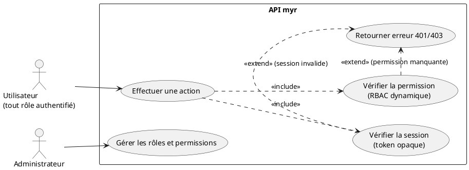
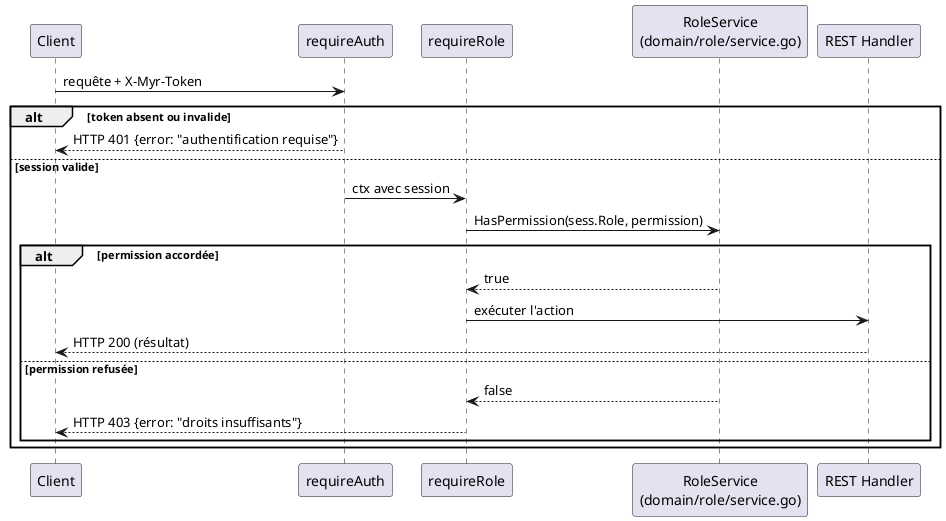

# Vérification des accès du rôle attribué

## Diagramme d'acteurs

## Contexte

Le contrôle d'accès repose sur deux couches, toutes deux dans `adapters/in/rest/handlers.go` :

1. **Authentification** (`requireAuth`) — vérifie que le token opaque `X-Myr-Token` correspond à une session active et non expirée. Retourne `401` sinon.
2. **Autorisation** (`requireRole`) — vérifie que le rôle de la session porte la **permission** requise pour l'action, via `domain/role.RoleService.HasPermission(role, permission)`. Retourne `403` sinon.

Les permissions forment un catalogue plat (pas de hiérarchie implicite) : `read`, `write`, `network.admin`, `role.admin`, `identity.admin`, `admin`. Un rôle est une association arbitraire à un sous-ensemble de ces permissions (RBAC dynamique, `domain/role`), pas une simple étiquette ordonnée.

La table des rôles et de leurs permissions est celle du réseau, publiée sur le ledger et appliquée à l'identique par le chaincode et par chaque serveur (RM48, ADR-12). Tant qu'aucune n'est publiée, la table initiale s'applique : `reader`, `contributor`, `auditor`, `admin` (voir `myr role list`). Un administrateur peut ajouter des rôles (ex. `consumer`, `manufacturer`) avec n'importe quel sous-ensemble de permissions, modifier ou supprimer tout rôle sauf `admin`, qui porte toujours toutes les permissions (`myr role create|update|delete`, UCADM07). Le serveur relit la table au plus toutes les 30 secondes ; s'il ne peut plus la lire, il applique la dernière lue, à défaut la table initiale. Un rôle supprimé, encore porté par une identité, ne lui accorde plus aucune permission.

**Si aucun `role.RoleService` n'est injecté** dans le serveur (config minimale), `requireRole` retombe sur une hiérarchie historique câblée en dur : `reader(1) < contributor(2) < admin(3)`, comparée au rang requis par la permission (`legacyRoleRank` / `legacyPermRank` dans `handlers.go`).

## Pré-conditions

- L'utilisateur dispose d'un token de session valide (UCA02)
- Un rôle est associé à la session : celui que porte le certificat de l'identité à la connexion (UCA02, RM45)

## Scénario

### Flux nominal — Action autorisée

1. Le client envoie la requête avec `X-Myr-Token: <token>`
2. `requireAuth` retrouve la session ; `requireRole` vérifie `roleSvc.HasPermission(sess.Role, permission_requise)`
3. La permission est accordée — l'action est exécutée normalement

<!-- tests-obsidian:begin — tests rattachés à cette exigence, section générée : ne pas l'éditer à la main -->
> [!check]- Tests — 0 explicite(s) · 10 déduit(s)
> - 🟡 [TestCreate_NoTable_Rejected](../../../docs/tests/domain-role/TestCreate_NoTable_Rejected.md) — déduit : teste `RoleService.HasPermission`
> - 🟡 [TestDelete_Success](../../../docs/tests/domain-role/TestDelete_Success.md) — déduit : teste `RoleService.HasPermission`
> - 🟡 [TestHasPermission_DefaultTable](../../../docs/tests/domain-role/TestHasPermission_DefaultTable.md) — déduit : teste `RoleService.HasPermission`
> - 🟡 [TestHasPermission_UnknownRole](../../../docs/tests/domain-role/TestHasPermission_UnknownRole.md) — déduit : teste `RoleService.HasPermission`
> - 🟡 [TestTable_RM48_AdminAlwaysImmutable](../../../docs/tests/domain-role/TestTable_RM48_AdminAlwaysImmutable.md) — déduit : teste `RoleService.HasPermission`
> - 🟡 [TestTable_RM48_Unreachable_LastKnownTable](../../../docs/tests/domain-role/TestTable_RM48_Unreachable_LastKnownTable.md) — déduit : teste `RoleService.HasPermission`
> - 🟡 [TestTable_RM48_Unreachable_NeverRead_DefaultRoles](../../../docs/tests/domain-role/TestTable_RM48_Unreachable_NeverRead_DefaultRoles.md) — déduit : teste `RoleService.HasPermission`
> - 🟡 [TestUpdate_RM47_AutoGrantWithAdminPermission_Rejected](../../../docs/tests/domain-role/TestUpdate_RM47_AutoGrantWithAdminPermission_Rejected.md) — déduit : teste `RoleService.HasPermission`
> - 🟡 [TestUpdate_RM48_DefaultRoleEditable](../../../docs/tests/domain-role/TestUpdate_RM48_DefaultRoleEditable.md) — déduit : teste `RoleService.HasPermission`
> - 🟡 [TestUpdate_Success](../../../docs/tests/domain-role/TestUpdate_Success.md) — déduit : teste `RoleService.HasPermission`
<!-- tests-obsidian:end -->

### Flux erreur — Session absente ou invalide (401)

1. Aucun token, ou token inconnu/expiré
2. `requireAuth` retourne `HTTP 401` avec `{"error": "authentification requise"}`

<!-- tests-obsidian:begin — tests rattachés à cette exigence, section générée : ne pas l'éditer à la main -->
> [!warning] Tests — aucun test ne couvre cette exigence
> [Matrice de couverture](../../../docs/tests/Matrice_Couverture_Tests.md)
<!-- tests-obsidian:end -->

### Flux erreur — Permission insuffisante (403)

1. La session est valide mais `HasPermission` retourne `false` pour la permission requise (ou repli sur `legacyRoleRank` si aucun `RoleService` injecté)
2. `requireRole` retourne `HTTP 403` avec `{"error": "droits insuffisants"}`

<!-- tests-obsidian:begin — tests rattachés à cette exigence, section générée : ne pas l'éditer à la main -->
> [!check]- Tests — 0 explicite(s) · 10 déduit(s)
> - 🟡 [TestCreate_NoTable_Rejected](../../../docs/tests/domain-role/TestCreate_NoTable_Rejected.md) — déduit : teste `RoleService.HasPermission`
> - 🟡 [TestDelete_Success](../../../docs/tests/domain-role/TestDelete_Success.md) — déduit : teste `RoleService.HasPermission`
> - 🟡 [TestHasPermission_DefaultTable](../../../docs/tests/domain-role/TestHasPermission_DefaultTable.md) — déduit : teste `RoleService.HasPermission`
> - 🟡 [TestHasPermission_UnknownRole](../../../docs/tests/domain-role/TestHasPermission_UnknownRole.md) — déduit : teste `RoleService.HasPermission`
> - 🟡 [TestTable_RM48_AdminAlwaysImmutable](../../../docs/tests/domain-role/TestTable_RM48_AdminAlwaysImmutable.md) — déduit : teste `RoleService.HasPermission`
> - 🟡 [TestTable_RM48_Unreachable_LastKnownTable](../../../docs/tests/domain-role/TestTable_RM48_Unreachable_LastKnownTable.md) — déduit : teste `RoleService.HasPermission`
> - 🟡 [TestTable_RM48_Unreachable_NeverRead_DefaultRoles](../../../docs/tests/domain-role/TestTable_RM48_Unreachable_NeverRead_DefaultRoles.md) — déduit : teste `RoleService.HasPermission`
> - 🟡 [TestUpdate_RM47_AutoGrantWithAdminPermission_Rejected](../../../docs/tests/domain-role/TestUpdate_RM47_AutoGrantWithAdminPermission_Rejected.md) — déduit : teste `RoleService.HasPermission`
> - 🟡 [TestUpdate_RM48_DefaultRoleEditable](../../../docs/tests/domain-role/TestUpdate_RM48_DefaultRoleEditable.md) — déduit : teste `RoleService.HasPermission`
> - 🟡 [TestUpdate_Success](../../../docs/tests/domain-role/TestUpdate_Success.md) — déduit : teste `RoleService.HasPermission`
<!-- tests-obsidian:end -->

## Post-conditions

- Si autorisé : l'action est exécutée, le rôle de la session n'est pas modifié
- Si refusé : aucun effet de bord, l'état du système est inchangé

## Diagramme de séquence

## Règles métier déclenchées

- **RM22** — Tout accès à une action protégée déclenche une vérification côté serveur (session + permission). Le client ne peut pas contourner ce contrôle : le token est opaque, non forgeable.
- **RM48** — La permission est lue dans la table des rôles du réseau ; `admin` les porte toutes.

## Exigences non-fonctionnelles

- **ENF12** — Le contrôle d'accès est strictement côté serveur.
- **ENF18** — `requireAuth`/`requireRole` (adapter `in/rest/`) ne contiennent que de l'orchestration ; la décision RBAC elle-même vit dans `domain/role`.

## Notes d'implémentation

**Composants réels :**
- `requireAuth`, `requireRole`, `legacyRoleRank`, `legacyPermRank` → `adapters/in/rest/handlers.go`
- Catalogue de permissions, table initiale, RBAC dynamique → `domain/role/entity.go`, `service.go` ; table publiée sur le ledger → `adapters/out/fabric/role_store.go` (chaincode `GetRoles`)
- Gestion des rôles : `myr role list|show|create|update|delete` (CLI uniquement — aucun endpoint REST de gestion des rôles, seulement une consultation implicite via l'usage du middleware)

**Pas de JWT :** aucune claim signée n'est en jeu ici — la « vérification du rôle » se fait en interrogeant le store de sessions et le service RBAC à chaque requête, pas en décodant un token.

**Rôle figé à la connexion :** le rôle vérifié ici est celui fixé une fois pour toutes à la création de la session (UCA02) — un changement de rôle CA (UCA08) ne s'applique qu'à la prochaine connexion, pas à la session en cours.

<!-- liens-obsidian:begin — section de traçabilité générée à partir des références du document : ne pas l'éditer à la main -->
## Liens

**Étape suivante — conception**
- **Chaincode** : [§ 4. Fonctions chaincode — Store/Read (D3/D4/D6)](../../3-Conception/Chaincode.md#4.%20Fonctions%20chaincode%20—%20Store/Read%20%28D3/D4/D6%29)

<!-- liens-obsidian:end -->
