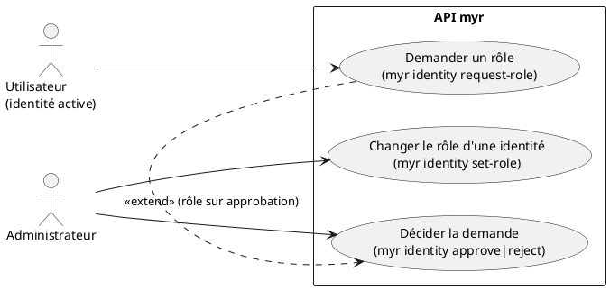
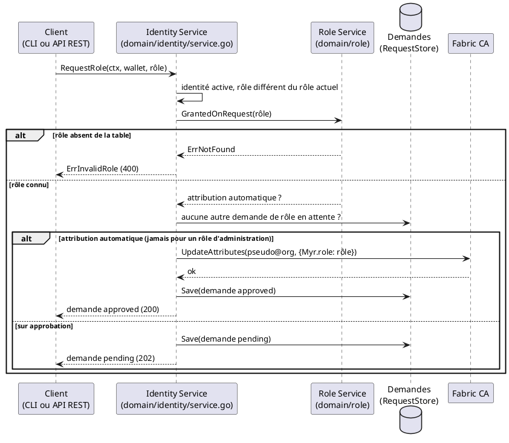

# Demander un rôle

## Diagramme d'acteurs



## Contexte

Une identité inscrite et active demande un rôle de la table des rôles du réseau (RM46) :

```
myr identity request-role <rôle>
POST /api/identity/roles/request   {"role": "<rôle>"}
```

Le CLI agit pour l'identité de son compte local (`myr session`), l'API pour l'identité de la session REST (`X-Myr-Token`). Les deux appellent `IdentityService.RequestRole` avec le wallet de cette identité, dont le certificat donne le rôle actuel.

Chaque rôle de la table porte un réglage d'attribution sur demande (`auto_grant`, `myr role create|update --auto-grant`, UCADM07) (RM47) :

| Réglage du rôle demandé | Effet de la demande |
|-------------------------|---------------------|
| Attribution automatique | Le rôle est attribué aussitôt (`Myr.role` mis à jour auprès de la CA) ; la demande est enregistrée approuvée |
| Sur approbation (défaut) | La demande est enregistrée en attente ; l'administrateur l'approuve (le rôle est attribué) ou la refuse (l'identité garde son rôle) |

Un rôle portant une permission d'administration (`admin`, `identity.admin`, `role.admin`, `network.admin`) n'est jamais attribué automatiquement, quel que soit son réglage : sa demande attend toujours l'approbation.

Une demande de rôle est une `AccountRequest` de type `role` (`Kind`), avec le rôle demandé (`Role`). Elle suit le cycle des demandes d'inscription : elle apparaît dans `myr identity requests` / `GET /api/identity/requests` et se décide par `myr identity approve|reject` / `POST /api/identity/requests/{id}/approve|reject` (RM44).

Le rôle d'une identité est un attribut de son certificat (`Myr.role`) : le nouveau rôle s'applique au prochain enrôlement de l'identité — à sa prochaine connexion (`POST /api/identity/session`, RM45) ou par `myr identity re-enroll <pseudo@org>`. C'est une propriété de la Fabric CA.

L'administrateur peut aussi changer directement le rôle d'une identité, sans demande : `myr identity set-role --id <pseudo@org> --role <rôle>` (`IdentityService.SetRole` → `CAPort.UpdateAttributes`).

## Pré-conditions

- L'identité existe auprès de la CA et son certificat la déclare active (UCA01, UCA02)
- CLI : un compte local (`myr session`) désigne l'identité et son wallet est présent sur le nœud ; API : une session REST est ouverte pour l'identité

## Scénario

### Flux nominal — Rôle en attribution automatique

1. L'identité demande le rôle `consumer`, en attribution automatique : `myr identity request-role consumer`
2. Le service vérifie que l'identité est active, que le rôle figure dans la table et diffère de son rôle actuel, et qu'aucune autre demande de rôle de l'identité n'est en attente
3. Le service attribue le rôle : `CAPort.UpdateAttributes(ctx, "pseudo@org", {"Myr.role": "consumer"})`
4. La demande est enregistrée au statut `approved`
5. Le CLI affiche : « Rôle consumer attribué à pseudo@org. Il s'applique au prochain ré-enrôlement de l'identité (myr identity re-enroll). » ; l'API répond `200 OK` avec la demande

<!-- tests-obsidian:begin — tests rattachés à cette exigence, section générée : ne pas l'éditer à la main -->
> [!check]- Tests — 0 explicite(s) · 6 déduit(s)
> - 🟡 [TestRunIdentityReEnroll_NoLocalWallet_Rejected](../../../docs/tests/adapters-in-cli/TestRunIdentityReEnroll_NoLocalWallet_Rejected.md) — déduit : teste commande `myr identity re-enroll`
> - 🟡 [TestRunIdentityReEnroll_NominalCase](../../../docs/tests/adapters-in-cli/TestRunIdentityReEnroll_NominalCase.md) — déduit : teste commande `myr identity re-enroll`
> - 🟡 [TestRunIdentityRequestRole_RM47_GrantedOrPending](../../../docs/tests/adapters-in-cli/TestRunIdentityRequestRole_RM47_GrantedOrPending.md) — déduit : teste commande `myr identity request-role`
> - 🟡 [TestSessionIdentity](../../../docs/tests/adapters-in-cli/TestSessionIdentity.md) — déduit : teste commande `myr identity request-role`
> - 🟡 [TestCAClient_IdentityPath_NonASCIIEnrollmentID](../../../docs/tests/adapters-out-fabric/TestCAClient_IdentityPath_NonASCIIEnrollmentID.md) — déduit : teste `CAPort.UpdateAttributes`
> - 🟡 [TestCAClient_UpdateAttributes_SEC1AndPKCS8Keys](../../../docs/tests/adapters-out-fabric/TestCAClient_UpdateAttributes_SEC1AndPKCS8Keys.md) — déduit : teste `CAPort.UpdateAttributes`
<!-- tests-obsidian:end -->

### Flux alternatif — Rôle sur approbation

1. L'identité demande le rôle `contributor`, sur approbation
2. Mêmes vérifications qu'au flux nominal ; la CA n'est pas modifiée
3. La demande est enregistrée au statut `pending` ; l'API répond `202 Accepted` avec la demande
4. L'administrateur la voit dans `myr identity requests` (type `rôle`, rôle demandé) et l'approuve : `myr identity approve <id>`
5. Le service vérifie que le rôle figure toujours dans la table (RM46), puis l'attribue (`Myr.role`) ; la demande passe au statut `approved`
6. S'il la refuse (`myr identity reject <id>`), l'identité garde son rôle — son statut n'est pas modifié — et la demande passe au statut `rejected`

<!-- tests-obsidian:begin — tests rattachés à cette exigence, section générée : ne pas l'éditer à la main -->
> [!check]- Tests — 0 explicite(s) · 3 déduit(s)
> - 🟡 [TestRunIdentityDecision_Approve_OK](../../../docs/tests/adapters-in-cli/TestRunIdentityDecision_Approve_OK.md) — déduit : teste commande `myr identity approve`, commande `myr identity reject`
> - 🟡 [TestRunIdentityDecision_NotPending_Rejected](../../../docs/tests/adapters-in-cli/TestRunIdentityDecision_NotPending_Rejected.md) — déduit : teste commande `myr identity approve`, commande `myr identity reject`
> - 🟡 [TestRunIdentityRequests_NominalCase](../../../docs/tests/adapters-in-cli/TestRunIdentityRequests_NominalCase.md) — déduit : teste commande `myr identity requests`
<!-- tests-obsidian:end -->

### Flux alternatif — Changement direct par l'administrateur

1. L'administrateur exécute `myr identity set-role --id <pseudo@org> --role <rôle>`
2. Le service vérifie que le rôle figure dans la table (RM46) et met à jour `Myr.role` auprès de la CA
3. Le CLI affiche : « Rôle de "pseudo@org" mis à jour : rôle. Le nouveau rôle s'applique au prochain ré-enrôlement de l'identité. »

<!-- tests-obsidian:begin — tests rattachés à cette exigence, section générée : ne pas l'éditer à la main -->
> [!check]- Tests — 0 explicite(s) · 1 déduit(s)
> - 🟡 [TestRunIdentitySetRole_NominalCase](../../../docs/tests/adapters-in-cli/TestRunIdentitySetRole_NominalCase.md) — déduit : teste commande `myr identity set-role`
<!-- tests-obsidian:end -->

### Flux erreur — Demande refusée

1. Rôle déjà détenu : `ErrRoleAlreadyHeld`, « Vous possédez déjà ce rôle » — `400 Bad Request`
2. Rôle absent de la table : `ErrInvalidRole` (RM46) — `400 Bad Request`
3. Autre demande de rôle de l'identité déjà en attente : `ErrRequestAlreadyPending` — `409 Conflict`
4. Identité en attente, suspendue ou sans rôle : `403 Forbidden`
5. Sans session REST : `401 Unauthorized` ; sans compte local CLI : la commande indique de le créer (`myr session create`)

Aucune demande n'est enregistrée et la CA n'est pas modifiée.

<!-- tests-obsidian:begin — tests rattachés à cette exigence, section générée : ne pas l'éditer à la main -->
> [!check]- Tests — 0 explicite(s) · 2 déduit(s)
> - 🟡 [TestRunSessionCreate_AlreadyExists_Rejected](../../../docs/tests/adapters-in-cli/TestRunSessionCreate_AlreadyExists_Rejected.md) — déduit : teste commande `myr session create`
> - 🟡 [TestRunSessionCreate_NominalCase](../../../docs/tests/adapters-in-cli/TestRunSessionCreate_NominalCase.md) — déduit : teste commande `myr session create`
<!-- tests-obsidian:end -->

### Flux erreur — Approbation d'un rôle retiré de la table

1. Le rôle demandé a été supprimé de la table depuis la demande
2. `myr identity approve <id>` est refusé (`ErrInvalidRole`, RM46) — `400 Bad Request` côté API
3. La demande reste en attente ; la CA n'est pas modifiée

<!-- tests-obsidian:begin — tests rattachés à cette exigence, section générée : ne pas l'éditer à la main -->
> [!check]- Tests — 0 explicite(s) · 2 déduit(s)
> - 🟡 [TestRunIdentityDecision_Approve_OK](../../../docs/tests/adapters-in-cli/TestRunIdentityDecision_Approve_OK.md) — déduit : teste commande `myr identity approve`
> - 🟡 [TestRunIdentityDecision_NotPending_Rejected](../../../docs/tests/adapters-in-cli/TestRunIdentityDecision_NotPending_Rejected.md) — déduit : teste commande `myr identity approve`
<!-- tests-obsidian:end -->

## Post-conditions

- Attribution automatique ou demande approuvée : l'attribut `Myr.role` de l'identité est mis à jour auprès de la CA ; le nouveau rôle prend effet au prochain enrôlement de l'identité
- Demande en attente : l'identité garde son rôle jusqu'à la décision de l'administrateur
- Demande refusée : l'identité garde son rôle et son statut ; la demande est conservée

## Diagramme de séquence



## Règles métier déclenchées

- **RM44** — Une demande en attente se décide une seule fois ; refuser une demande de rôle laisse l'identité inchangée.
- **RM46** — Le rôle demandé, puis approuvé, doit figurer dans la table des rôles ; un rôle inconnu est refusé.
- **RM47** — Le réglage du rôle décide : attribution automatique ou approbation ; jamais automatique pour un rôle d'administration.

## Exigences non-fonctionnelles

- **ENF12** — L'attribution de rôle est strictement côté serveur/CA : le client ne transmet que le rôle souhaité, jamais son rôle actuel, lu dans le certificat de l'identité.

## Notes d'implémentation

**Commandes et routes :** `myr identity request-role <rôle>` et `POST /api/identity/roles/request` → `IdentityService.RequestRole` (`domain/identity/service.go`) ; décision : `myr identity approve|reject <id>`, `POST /api/identity/requests/{id}/approve|reject` → `ApproveRequest` / `RejectRequest` ; changement direct : `myr identity set-role` → `SetRole`.

**Réglage d'attribution :** champ `AutoGrant` de `domain/role.Role`, publié avec la table des rôles sur le ledger (`specs/3-Conception/Chaincode.md` §4.3) ; décision par `role.GrantedOnRequest`.

**Ré-enrôlement CLI :** `myr identity re-enroll <pseudo@org>` (`adapters/in/cli/identity.go`) → `IdentityService.ReEnroll` : émet un nouveau certificat portant le rôle à jour, sans passer par une session REST.

<!-- liens-obsidian:begin — section de traçabilité générée à partir des références du document : ne pas l'éditer à la main -->
## Liens

**Étape suivante — conception**
- **API_REST** : [§ 2. D1 — Identité & RBAC](../../3-Conception/API_REST.md#2.%20D1%20—%20Identité%20&%20RBAC)
- **Conception_intro** : [§ ADR-12 — Invariants portés par le chaincode, signature par l'utilisateur, autorisation par le certificat](../../3-Conception/Conception_intro.md#ADR-12%20—%20Invariants%20portés%20par%20le%20chaincode,%20signature%20par%20l'utilisateur,%20autorisation%20par%20le%20certificat)
- **DC_CLI_Identity** : [§ DC — CLI Identité & Session : Référence des commandes `myr identity` / `myr session`](../../3-Conception/DC_CLI_Identity.md#DC%20—%20CLI%20Identité%20&%20Session%20:%20Référence%20des%20commandes%20`myr%20identity`%20/%20`myr%20session`) · [§ 2. Arbre de commandes](../../3-Conception/DC_CLI_Identity.md#2.%20Arbre%20de%20commandes) · [§ 3.4 `myr identity re-enroll`](../../3-Conception/DC_CLI_Identity.md#3.4%20`myr%20identity%20re-enroll`) · [§ 3.5b `myr identity approve` / `reject`](../../3-Conception/DC_CLI_Identity.md#3.5b%20`myr%20identity%20approve`%20/%20`reject`) · [§ 3.6b `myr identity request-role`](../../3-Conception/DC_CLI_Identity.md#3.6b%20`myr%20identity%20request-role`) · [§ 3.7 `myr identity set-role`](../../3-Conception/DC_CLI_Identity.md#3.7%20`myr%20identity%20set-role`)
- **DC_D1_Auth_Identity** : [§ AccountRequest (`domain/identity`)](../../3-Conception/DC_D1_Auth_Identity.md#AccountRequest%20%28`domain/identity`%29) · [§ Role / Permission (`domain/role`)](../../3-Conception/DC_D1_Auth_Identity.md#Role%20/%20Permission%20%28`domain/role`%29)

<!-- liens-obsidian:end -->
