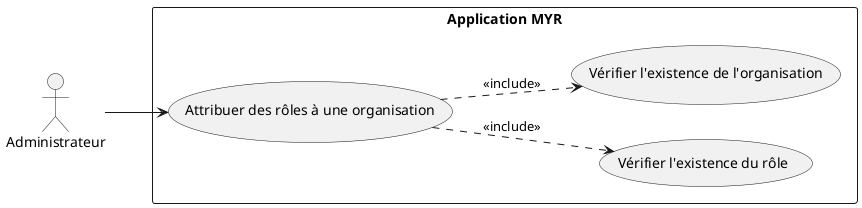
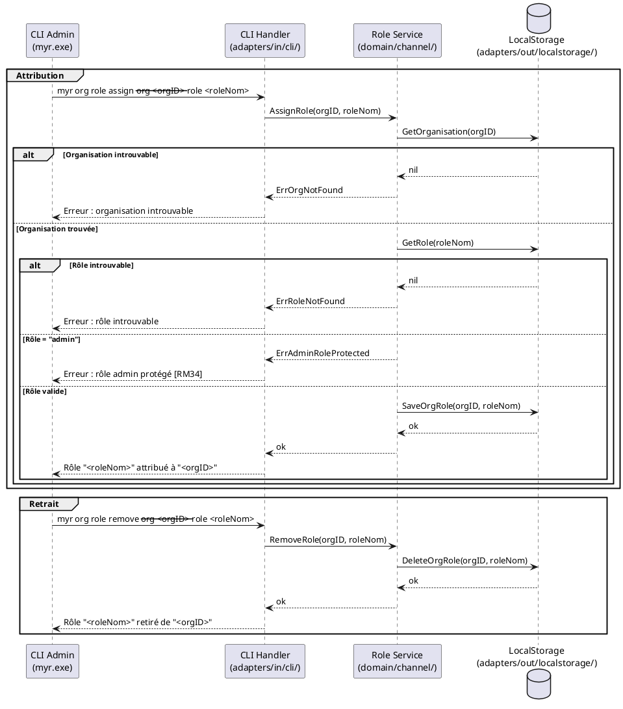

# Attribuer des rôles à une organisation

## Diagramme d'acteurs

## Contexte

Après qu'une organisation a été ajoutée au réseau (UCADM01), l'administrateur peut lui attribuer un ou plusieurs rôles. Un **rôle** est un ensemble nommé de droits d'accès défini séparément (UCADM07). L'attribution d'un rôle à une organisation confère à tous ses membres les droits correspondants (RM37).

L'attribution est publiée sur le ledger avec la table des rôles (un exemplaire par canal, RM48) : le chaincode comme chaque serveur l'appliquent à toute identité de l'organisation (MSP). Elle est réversible à tout moment.

Un rôle s'attribue à la fois à une identité — par son certificat (`Myr.role`, `myr identity register|set-role` ou demande de rôle, UCA08) — et à une organisation (UCADM06) : les droits effectifs d'une identité sont l'union des droits de son rôle et de ceux des rôles attribués à son organisation (RM37, RM48). Décision du product owner du 2026-11-08, à réévaluer lors de la phase alpha.

Le rôle `admin` est natif et protégé : il ne peut pas être attribué à d'autres organisations via cette interface (RM34).

## Pré-conditions

- L'administrateur est authentifié avec le rôle `admin` (session SSH sur le serveur).
- L'organisation cible existe sur le réseau (UCADM01 réalisé).
- Au moins un rôle disponible (autre que `admin`) existe (UCADM07 réalisé).

## Scénario

**Étape initiale :** L'administrateur exécute la commande d'attribution via le CLI admin (`myr.exe`).

### Flux nominal — Rôle attribué avec succès

1. L'administrateur fournit l'identifiant d'organisation et le nom du rôle à attribuer.
2. Le CLI Handler appelle le `Role Service` (`domain/channel/`).
3. Le service vérifie que l'organisation existe sur le réseau.
4. Le service vérifie que le rôle existe et n'est pas le rôle `admin`.
5. Le service crée la liaison organisation ↔ rôle et la persiste localement.
6. Le CLI retourne : `Rôle "<roleNom>" attribué à l'organisation "<orgID>".`

<!-- tests-obsidian:begin — tests rattachés à cette exigence, section générée : ne pas l'éditer à la main -->
> [!warning] Tests — aucun test ne couvre cette exigence
> [Matrice de couverture](../../../docs/tests/Matrice_Couverture_Tests.md)
<!-- tests-obsidian:end -->

### Flux alternatif — Retrait d'un rôle

1. L'administrateur exécute `myr org role remove --org <orgID> --role <roleNom>`.
2. Le service vérifie que la liaison existe.
3. La liaison est supprimée du stockage local.
4. Le CLI retourne : `Rôle "<roleNom>" retiré de l'organisation "<orgID>".`

<!-- tests-obsidian:begin — tests rattachés à cette exigence, section générée : ne pas l'éditer à la main -->
> [!warning] Tests — aucun test ne couvre cette exigence
> [Matrice de couverture](../../../docs/tests/Matrice_Couverture_Tests.md)
<!-- tests-obsidian:end -->

### Flux erreur — Organisation introuvable

1. L'identifiant fourni ne correspond à aucune organisation connue du système.
2. Le service retourne `ErrOrgNotFound`.
3. Le CLI retourne : `Erreur : organisation "<orgID>" introuvable sur le réseau.`

<!-- tests-obsidian:begin — tests rattachés à cette exigence, section générée : ne pas l'éditer à la main -->
> [!warning] Tests — aucun test ne couvre cette exigence
> [Matrice de couverture](../../../docs/tests/Matrice_Couverture_Tests.md)
<!-- tests-obsidian:end -->

### Flux erreur — Rôle introuvable

1. Le nom de rôle fourni n'existe pas dans le système.
2. Le service retourne `ErrRoleNotFound`.
3. Le CLI retourne : `Erreur : rôle "<roleNom>" introuvable. Créez-le avec "myr role create".`

<!-- tests-obsidian:begin — tests rattachés à cette exigence, section générée : ne pas l'éditer à la main -->
> [!warning] Tests — aucun test ne couvre cette exigence
> [Matrice de couverture](../../../docs/tests/Matrice_Couverture_Tests.md)
<!-- tests-obsidian:end -->

### Flux erreur — Tentative d'attribution du rôle admin

1. L'administrateur tente d'attribuer le rôle `admin` à une organisation.
2. Le service refuse l'opération (RM34).
3. Le CLI retourne : `Erreur : le rôle "admin" est protégé et ne peut pas être attribué via cette commande.`

<!-- tests-obsidian:begin — tests rattachés à cette exigence, section générée : ne pas l'éditer à la main -->
> [!warning] Tests — aucun test ne couvre cette exigence
> [Matrice de couverture](../../../docs/tests/Matrice_Couverture_Tests.md)
<!-- tests-obsidian:end -->

## Post-conditions

- **Attribution :** La liaison organisation ↔ rôle est publiée sur le ledger. Les droits associés au rôle sont effectifs pour toutes les identités de l'organisation, en plus de ceux de leur propre rôle (RM37).
- **Retrait :** La liaison est supprimée, les droits correspondants sont révoqués.

## Diagramme de séquence

## Règles métier déclenchées

| Règle | Description |
|-------|-------------|
| **RM34** | Le rôle `admin` est protégé — il ne peut pas être attribué à une organisation tierce |
| **RM37** | Une organisation peut posséder plusieurs rôles — ses droits effectifs sont l'union des droits de ses rôles |

## Exigences non-fonctionnelles

| ID | Exigence |
|----|---------|
| **EF10** | Gérer les droits d'accès des organisations sur le réseau |
| **ENF18** | Le domaine `channel` ne contient aucune dépendance directe au backend (vérifiée par CI) |

## Notes d'implémentation

**Composants :**
- Attribution organisation ↔ rôles : `domain/role` (même service que la table des rôles, `RoleService`), publiée sur le ledger par `adapters/out/fabric/role_store.go` avec la table, sur chaque canal du réseau.
- Contrôle des écritures : le chaincode accorde une permission si le rôle du certificat du signataire ou l'un des rôles de son organisation (MSP du signataire) la porte (`specs/3-Conception/Chaincode.md` §4.3) ; le serveur applique la même union aux actions hors ledger.
- CLI : `myr org role assign --org <orgID> --role <rôle>` et `myr org role remove --org <orgID> --role <rôle>` (`adapters/in/cli/org.go`).

<!-- liens-obsidian:begin — section de traçabilité générée à partir des références du document : ne pas l'éditer à la main -->
## Liens

**Étape suivante — conception**
- **Chaincode** : [§ 4.1 Invariants appliqués par `StoreModel` (ADR-12)](../../3-Conception/Chaincode.md#4.1%20Invariants%20appliqués%20par%20`StoreModel`%20%28ADR-12%29) · [§ 4.3 Table des rôles (ADR-12, RM48)](../../3-Conception/Chaincode.md#4.3%20Table%20des%20rôles%20%28ADR-12,%20RM48%29)
- **Conception_intro** : [§ ADR-12 — Invariants portés par le chaincode, signature par l'utilisateur, autorisation par le certificat](../../3-Conception/Conception_intro.md#ADR-12%20—%20Invariants%20portés%20par%20le%20chaincode,%20signature%20par%20l'utilisateur,%20autorisation%20par%20le%20certificat)
- **DC_CLI_Admin** : [§ 4.2 `myr org role assign` *(UCADM06)*](../../3-Conception/DC_CLI_Admin.md#4.2%20`myr%20org%20role%20assign`%20*%28UCADM06%29*) · [§ 4.3 `myr org role remove` *(UCADM06)*](../../3-Conception/DC_CLI_Admin.md#4.3%20`myr%20org%20role%20remove`%20*%28UCADM06%29*) · [§ 7.2 `RoleService` (port_in) *(UCADM06/07)*](../../3-Conception/DC_CLI_Admin.md#7.2%20`RoleService`%20%28port_in%29%20*%28UCADM06/07%29*) · [§ 7.5 `RoleStore` (port_out) *(UCADM06/07)*](../../3-Conception/DC_CLI_Admin.md#7.5%20`RoleStore`%20%28port_out%29%20*%28UCADM06/07%29*) · [§ 11. Écarts code → specs](../../3-Conception/DC_CLI_Admin.md#11.%20Écarts%20code%20→%20specs)
- **DC_D2_Administration** : [§ DC — D2 : Administration réseau](../../3-Conception/DC_D2_Administration.md#DC%20—%20D2%20:%20Administration%20réseau) · [§ OrgRole (domain/channel)](../../3-Conception/DC_D2_Administration.md#OrgRole%20%28domain/channel%29) · [§ Entités à concevoir (non présentes dans le code)](../../3-Conception/DC_D2_Administration.md#Entités%20à%20concevoir%20%28non%20présentes%20dans%20le%20code%29) · [§ 8. Écarts code → specs](../../3-Conception/DC_D2_Administration.md#8.%20Écarts%20code%20→%20specs)

<!-- liens-obsidian:end -->
