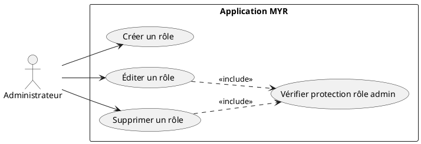
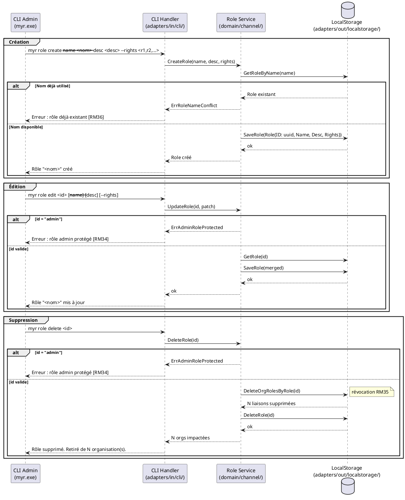

# Gérer les rôles

## Diagramme d'acteurs

## Contexte

L'administrateur gère les **rôles** disponibles dans le système MYR. La table des rôles est publiée sur le ledger, un exemplaire par canal du réseau, et appliquée à l'identique par le chaincode et par chaque serveur (RM48, ADR-12) ; seule une identité dont le rôle porte `role.admin` la modifie, avec la signature de son wallet. Un rôle y est représenté par un nom unique, une liste de droits d'accès (permissions) et un réglage d'attribution sur demande (UCA08, RM47). Tant qu'aucune table n'est publiée, la table initiale s'applique (`reader`, `contributor`, `auditor`, `admin`). Les rôles sont ensuite attribués aux organisations (UCADM06).

#incoherence Ce use case et UCADM06 attribuent les rôles aux organisations (`OrgRole`, RM35), alors que l'ADR-12 porte le rôle dans le certificat de chaque identité (`Myr.role`, UCA08) et que la table des rôles ne comporte ni identifiant généré ni description. À trancher : attribution par organisation, par identité, ou les deux.

Le rôle `admin` est natif au système : il est initialisé automatiquement au démarrage du service et ne peut pas être modifié ni supprimé (RM34). Son `ID` est la valeur constante `"admin"`.

La suppression d'un rôle entraîne automatiquement sa révocation pour toutes les organisations qui le possédaient (RM35) — impact immédiat sur les droits en vigueur.

## Pré-conditions

- L'administrateur est authentifié avec le rôle `admin` (session SSH sur le serveur).

## Scénario

**Étape initiale :** L'administrateur exécute une commande de gestion de rôle via le CLI admin (`myr.exe`).

### Flux nominal — Rôle créé

1. L'administrateur fournit : nom, description, liste des droits accordés.
2. Le `Role Service` vérifie l'unicité du nom (RM36).
3. Le rôle est créé avec un ID généré et persisté localement via `adapters/out/localstorage/`.
4. Le CLI retourne : `Rôle "<nom>" créé avec les droits : <liste>.`

<!-- tests-obsidian:begin — tests rattachés à cette exigence, section générée : ne pas l'éditer à la main -->
> [!warning] Tests — aucun test ne couvre cette exigence
> [Matrice de couverture](../../../docs/tests/Matrice_Couverture_Tests.md)
<!-- tests-obsidian:end -->

### Flux nominal — Rôle édité

1. L'administrateur fournit l'identifiant du rôle et les champs à modifier.
2. Le service vérifie que l'ID n'est pas `"admin"` (RM34).
3. Les champs fournis sont mis à jour (merge — seuls les champs explicitement fournis sont écrasés).
4. Le rôle persisté est remplacé, les droits effectifs des organisations possédant ce rôle sont immédiatement mis à jour.
5. Le CLI retourne : `Rôle "<nom>" mis à jour.`

<!-- tests-obsidian:begin — tests rattachés à cette exigence, section générée : ne pas l'éditer à la main -->
> [!warning] Tests — aucun test ne couvre cette exigence
> [Matrice de couverture](../../../docs/tests/Matrice_Couverture_Tests.md)
<!-- tests-obsidian:end -->

### Flux nominal — Rôle supprimé

1. L'administrateur fournit l'identifiant du rôle à supprimer.
2. Le service vérifie que l'ID n'est pas `"admin"` (RM34).
3. Toutes les liaisons `OrgRole` référençant ce rôle sont supprimées (RM35).
4. Le rôle est supprimé du stockage.
5. Le CLI retourne : `Rôle "<nom>" supprimé. Retiré de <N> organisation(s).`

<!-- tests-obsidian:begin — tests rattachés à cette exigence, section générée : ne pas l'éditer à la main -->
> [!warning] Tests — aucun test ne couvre cette exigence
> [Matrice de couverture](../../../docs/tests/Matrice_Couverture_Tests.md)
<!-- tests-obsidian:end -->

### Flux erreur — Nom de rôle déjà utilisé (création)

1. Le nom fourni correspond à un rôle existant.
2. Le service retourne `ErrRoleNameConflict` (RM36).
3. Le CLI retourne : `Erreur : un rôle avec le nom "<nom>" existe déjà.`

<!-- tests-obsidian:begin — tests rattachés à cette exigence, section générée : ne pas l'éditer à la main -->
> [!warning] Tests — aucun test ne couvre cette exigence
> [Matrice de couverture](../../../docs/tests/Matrice_Couverture_Tests.md)
<!-- tests-obsidian:end -->

### Flux erreur — Tentative de modification du rôle admin

1. L'administrateur tente d'éditer ou de supprimer le rôle d'ID `"admin"`.
2. Le service retourne `ErrAdminRoleProtected` (RM34).
3. Le CLI retourne : `Erreur : le rôle "admin" est protégé et ne peut pas être modifié ni supprimé.`

<!-- tests-obsidian:begin — tests rattachés à cette exigence, section générée : ne pas l'éditer à la main -->
> [!warning] Tests — aucun test ne couvre cette exigence
> [Matrice de couverture](../../../docs/tests/Matrice_Couverture_Tests.md)
<!-- tests-obsidian:end -->

## Post-conditions

- **Création :** Le nouveau rôle est disponible pour attribution (UCADM06).
- **Édition :** Les organisations possédant ce rôle ont leurs droits mis à jour immédiatement.
- **Suppression :** Le rôle est dissocié de toutes les organisations (RM35) et supprimé du stockage local.

## Diagramme de séquence

## Règles métier déclenchées

| Règle | Description |
|-------|-------------|
| **RM34** | Le rôle `admin` est protégé — ID constant `"admin"`, ne peut être modifié ni supprimé |
| **RM35** | La suppression d'un rôle révoque automatiquement ses droits sur toutes les organisations |
| **RM36** | Le nom d'un rôle est unique dans le système |

## Exigences non-fonctionnelles

| ID | Exigence |
|----|---------|
| **EF10** | Gérer les droits d'accès des organisations sur le réseau |
| **ENF18** | Le domaine `channel` ne contient aucune dépendance directe au backend (vérifiée par CI) |

## Notes d'implémentation

**Composants :**
- Service et règles des rôles (table initiale, `admin` immuable, réglage d'attribution) : `domain/role` (`RoleService` : `Create`, `Update`, `Delete`, `Get`, `List`, `HasPermission`).
- Publication sur le ledger : `adapters/out/fabric/role_store.go` (port `role.Repo`), qui soumet `PutRole` / `DeleteRole` sur chaque canal du réseau et lit `GetRoles` sur son canal par défaut (`specs/3-Conception/Chaincode.md` §4.3).
- CLI : `myr role list|show|create|update|delete` (`adapters/in/cli/role.go`), signé par le wallet du compte local (`myr session`).

**Rôle admin :** il n'est jamais stocké différemment de la table initiale : le chaincode refuse de le modifier ou de le supprimer, et le domaine le rétablit dans sa définition complète à chaque lecture de la table.

<!-- liens-obsidian:begin — section de traçabilité générée à partir des références du document : ne pas l'éditer à la main -->
## Liens

**Étape suivante — conception**
- **Chaincode** : [§ 4. Fonctions chaincode — Store/Read (D3/D4/D6)](../../3-Conception/Chaincode.md#4.%20Fonctions%20chaincode%20—%20Store/Read%20%28D3/D4/D6%29)
- **DC_CLI_Admin** : [§ 5. Groupe `myr role` — Gestion des rôles *(UCADM07)*](../../3-Conception/DC_CLI_Admin.md#5.%20Groupe%20`myr%20role`%20—%20Gestion%20des%20rôles%20*%28UCADM07%29*) · [§ 5.2 `myr role create` *(UCADM07)*](../../3-Conception/DC_CLI_Admin.md#5.2%20`myr%20role%20create`%20*%28UCADM07%29*) · [§ 5.3 `myr role edit <id>` *(UCADM07)*](../../3-Conception/DC_CLI_Admin.md#5.3%20`myr%20role%20edit%20<id>`%20*%28UCADM07%29*) · [§ 5.4 `myr role delete <id>` *(UCADM07)*](../../3-Conception/DC_CLI_Admin.md#5.4%20`myr%20role%20delete%20<id>`%20*%28UCADM07%29*) · [§ 7.2 `RoleService` (port_in) *(UCADM06/07)*](../../3-Conception/DC_CLI_Admin.md#7.2%20`RoleService`%20%28port_in%29%20*%28UCADM06/07%29*) · [§ 7.5 `RoleStore` (port_out) *(UCADM06/07)*](../../3-Conception/DC_CLI_Admin.md#7.5%20`RoleStore`%20%28port_out%29%20*%28UCADM06/07%29*) · [§ 11. Écarts code → specs](../../3-Conception/DC_CLI_Admin.md#11.%20Écarts%20code%20→%20specs)
- **DC_D2_Administration** : [§ DC — D2 : Administration réseau](../../3-Conception/DC_D2_Administration.md#DC%20—%20D2%20:%20Administration%20réseau) · [§ Entités à concevoir (non présentes dans le code)](../../3-Conception/DC_D2_Administration.md#Entités%20à%20concevoir%20%28non%20présentes%20dans%20le%20code%29) · [§ 8. Écarts code → specs](../../3-Conception/DC_D2_Administration.md#8.%20Écarts%20code%20→%20specs)

<!-- liens-obsidian:end -->
