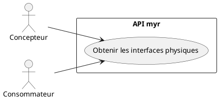
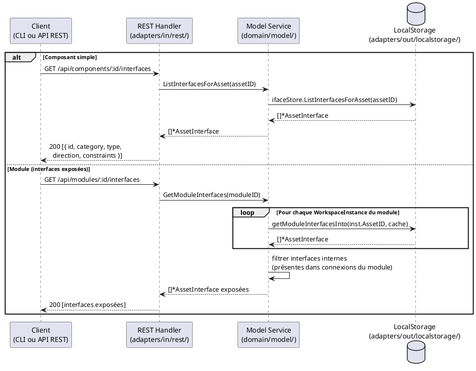

# Visualiser les interfaces physiques de composants

## Diagramme d'acteurs

## Contexte

Chaque composant ou module expose ses interfaces physiques (`AssetInterface`) comme points de connexion. Cette lecture est le prérequis de toute opération de liaison (UCAM01) ou de création d'interface (UCAM03) côté client.

Les interfaces sont persistées dans l'`InterfaceStore` local tant que l'asset qui les porte est en brouillon (ADR-02, `specs/3-Conception/Conception_intro.md`) — récupérées via `GET /api/components/:id/interfaces` ou `GET /api/modules/:id/interfaces`. Elles ne rejoignent la blockchain (`Model3D.Interfaces`) qu'à la soumission de l'asset.

Pour un module, les interfaces exposées sont calculées dynamiquement : seules les interfaces des sous-composants **non reliées en interne** sont exposées (`GetModuleInterfaces` — calcul récursif avec cache). Chaque instance du module contribue ses propres interfaces non reliées en interne, y compris lorsque plusieurs instances partagent le même asset sous-jacent : le cache de résolution récursive par asset ne doit jamais faire disparaître une instance de la liste exposée.

> La représentation visuelle (icônes, grisage, tooltip) relève du dépôt GUI externe — hors périmètre de ce document. Le contrat REST ci-dessous ainsi que son équivalent CLI (`myr model interface list`, voir Notes d'implémentation) font partie de `myr`.

## Pré-conditions

- L'utilisateur est authentifié (rôle **Lecteur** minimum)
- Un composant ou module est identifié (ID connu du client)
- L'`InterfaceStore` est configuré côté serveur

## Scénario

### Flux nominal — Interfaces d'un composant simple

1. Le client appelle `GET /api/components/:id/interfaces`
2. Le handler appelle `service.ListInterfacesForAsset(assetID)`, qui lit le brouillon local (`InterfaceStore`) si l'asset n'est pas encore soumis, sinon `Model3D.Interfaces` via `blockchain.GetModelRecord()`
3. La liste des interfaces est retournée : chaque interface contient `{ id, asset_id, name, category, type, direction, constraints }`

<!-- tests-obsidian:begin — tests rattachés à cette exigence, section générée : ne pas l'éditer à la main -->
> [!check]- Tests — 0 explicite(s) · 71 déduit(s)
> - 🟡 [TestAPIIntegration_AssetLifecycle](../../../docs/tests/adapters-in-rest/TestAPIIntegration_AssetLifecycle.md) — déduit : teste route `/api/components`
> - 🟡 [TestAPIIntegration_ConcurrentAssetCreation](../../../docs/tests/adapters-in-rest/TestAPIIntegration_ConcurrentAssetCreation.md) — déduit : teste route `/api/components`
> - 🟡 [TestAPIIntegration_InterfaceLifecycle](../../../docs/tests/adapters-in-rest/TestAPIIntegration_InterfaceLifecycle.md) — déduit : teste route `/api/components`
> - 🟡 [TestAPIIntegration_ModuleLifecycle](../../../docs/tests/adapters-in-rest/TestAPIIntegration_ModuleLifecycle.md) — déduit : teste route `/api/components`
> - 🟡 [TestComponentInterfaces_GET](../../../docs/tests/adapters-in-rest/TestComponentInterfaces_GET.md) — déduit : teste route `/api/components`
> - 🟡 [TestComponentInterfaces_POST_BadJSON](../../../docs/tests/adapters-in-rest/TestComponentInterfaces_POST_BadJSON.md) — déduit : teste route `/api/components`
> - 🟡 [TestComponentInterfaces_POST_Created](../../../docs/tests/adapters-in-rest/TestComponentInterfaces_POST_Created.md) — déduit : teste route `/api/components`
> - 🟡 [TestComponentTree_GET](../../../docs/tests/adapters-in-rest/TestComponentTree_GET.md) — déduit : teste route `/api/components`
> - 🟡 [TestComponentTree_MethodNotAllowed](../../../docs/tests/adapters-in-rest/TestComponentTree_MethodNotAllowed.md) — déduit : teste route `/api/components`
> - 🟡 [TestComponent_AddAssembly](../../../docs/tests/adapters-in-rest/TestComponent_AddAssembly.md) — déduit : teste route `/api/components`
> - 🟡 [TestComponent_AddAssembly_MissingConnectionID](../../../docs/tests/adapters-in-rest/TestComponent_AddAssembly_MissingConnectionID.md) — déduit : teste route `/api/components`
> - 🟡 [TestComponent_AddInstance](../../../docs/tests/adapters-in-rest/TestComponent_AddInstance.md) — déduit : teste route `/api/components`
> - 🟡 [TestComponent_AddInstance_MissingAssetID](../../../docs/tests/adapters-in-rest/TestComponent_AddInstance_MissingAssetID.md) — déduit : teste route `/api/components`
> - 🟡 [TestComponent_AddTwoInstancesSequentially](../../../docs/tests/adapters-in-rest/TestComponent_AddTwoInstancesSequentially.md) — déduit : teste route `/api/components`
> - 🟡 [TestComponent_DELETE_NoContent](../../../docs/tests/adapters-in-rest/TestComponent_DELETE_NoContent.md) — déduit : teste route `/api/components`
> - … et 56 autre(s) : voir la [matrice de couverture](../../../docs/tests/Matrice_Couverture_Tests.md)
<!-- tests-obsidian:end -->

### Flux nominal — Interfaces d'un module

1. Le client appelle `GET /api/modules/:id/interfaces`
2. Le handler appelle `service.GetModuleInterfaces(id)` — calcul récursif
3. Le service parcourt les `WorkspaceInstances` du module et collecte les interfaces de chaque sous-composant — une instance dont l'asset est partagé avec une autre instance du même module contribue quand même ses propres interfaces, séparément
4. Seules les interfaces non présentes dans une connexion interne au module sont retournées (interfaces "exposées")

<!-- tests-obsidian:begin — tests rattachés à cette exigence, section générée : ne pas l'éditer à la main -->
> [!check]- Tests — 0 explicite(s) · 8 déduit(s)
> - 🟡 [TestLegacyModulesAlias_GET_DelegatesToComponents](../../../docs/tests/adapters-in-rest/TestLegacyModulesAlias_GET_DelegatesToComponents.md) — déduit : teste route `/api/modules`
> - 🟡 [TestLegacyModulesAlias_ListRoute](../../../docs/tests/adapters-in-rest/TestLegacyModulesAlias_ListRoute.md) — déduit : teste route `/api/modules`
> - 🟡 [TestGetModuleInterfaces_InternalConnection_ScopedToInstance](../../../docs/tests/domain-model/TestGetModuleInterfaces_InternalConnection_ScopedToInstance.md) — déduit : teste `ModelService.GetModuleInterfaces`
> - 🟡 [TestGetModuleInterfaces_InternalConnectionsConsumed](../../../docs/tests/domain-model/TestGetModuleInterfaces_InternalConnectionsConsumed.md) — déduit : teste `ModelService.GetModuleInterfaces`
> - 🟡 [TestGetModuleInterfaces_MultipleInstancesSameAsset_AllExposed](../../../docs/tests/domain-model/TestGetModuleInterfaces_MultipleInstancesSameAsset_AllExposed.md) — déduit : teste `ModelService.GetModuleInterfaces`
> - 🟡 [TestGetModuleInterfaces_NilStore](../../../docs/tests/domain-model/TestGetModuleInterfaces_NilStore.md) — déduit : teste `ModelService.GetModuleInterfaces`
> - 🟡 [TestGetModuleInterfaces_RM52_LegacyCycle_Terminates](../../../docs/tests/domain-model/TestGetModuleInterfaces_RM52_LegacyCycle_Terminates.md) — déduit : teste `ModelService.GetModuleInterfaces`
> - 🟡 [TestGetModuleInterfaces_SimpleComponent](../../../docs/tests/domain-model/TestGetModuleInterfaces_SimpleComponent.md) — déduit : teste `ModelService.GetModuleInterfaces`
<!-- tests-obsidian:end -->

### Flux erreur — InterfaceStore non configuré

1. Le service `ListInterfacesForAsset()` retourne `nil, nil` (pas d'erreur — juste une liste vide)

<!-- tests-obsidian:begin — tests rattachés à cette exigence, section générée : ne pas l'éditer à la main -->
> [!warning] Tests — aucun test ne couvre cette exigence
> [Matrice de couverture](../../../docs/tests/Matrice_Couverture_Tests.md)
<!-- tests-obsidian:end -->

### Flux erreur — Asset introuvable

1. `GET /api/components/:id/interfaces` pour un ID inexistant
2. Le handler retourne HTTP 404 ou une liste vide selon l'état du store

<!-- tests-obsidian:begin — tests rattachés à cette exigence, section générée : ne pas l'éditer à la main -->
> [!check]- Tests — 0 explicite(s) · 59 déduit(s)
> - 🟡 [TestAPIIntegration_AssetLifecycle](../../../docs/tests/adapters-in-rest/TestAPIIntegration_AssetLifecycle.md) — déduit : teste route `/api/components`
> - 🟡 [TestAPIIntegration_ConcurrentAssetCreation](../../../docs/tests/adapters-in-rest/TestAPIIntegration_ConcurrentAssetCreation.md) — déduit : teste route `/api/components`
> - 🟡 [TestAPIIntegration_InterfaceLifecycle](../../../docs/tests/adapters-in-rest/TestAPIIntegration_InterfaceLifecycle.md) — déduit : teste route `/api/components`
> - 🟡 [TestAPIIntegration_ModuleLifecycle](../../../docs/tests/adapters-in-rest/TestAPIIntegration_ModuleLifecycle.md) — déduit : teste route `/api/components`
> - 🟡 [TestComponentInterfaces_GET](../../../docs/tests/adapters-in-rest/TestComponentInterfaces_GET.md) — déduit : teste route `/api/components`
> - 🟡 [TestComponentInterfaces_POST_BadJSON](../../../docs/tests/adapters-in-rest/TestComponentInterfaces_POST_BadJSON.md) — déduit : teste route `/api/components`
> - 🟡 [TestComponentInterfaces_POST_Created](../../../docs/tests/adapters-in-rest/TestComponentInterfaces_POST_Created.md) — déduit : teste route `/api/components`
> - 🟡 [TestComponentTree_GET](../../../docs/tests/adapters-in-rest/TestComponentTree_GET.md) — déduit : teste route `/api/components`
> - 🟡 [TestComponentTree_MethodNotAllowed](../../../docs/tests/adapters-in-rest/TestComponentTree_MethodNotAllowed.md) — déduit : teste route `/api/components`
> - 🟡 [TestComponent_AddAssembly](../../../docs/tests/adapters-in-rest/TestComponent_AddAssembly.md) — déduit : teste route `/api/components`
> - 🟡 [TestComponent_AddAssembly_MissingConnectionID](../../../docs/tests/adapters-in-rest/TestComponent_AddAssembly_MissingConnectionID.md) — déduit : teste route `/api/components`
> - 🟡 [TestComponent_AddInstance](../../../docs/tests/adapters-in-rest/TestComponent_AddInstance.md) — déduit : teste route `/api/components`
> - 🟡 [TestComponent_AddInstance_MissingAssetID](../../../docs/tests/adapters-in-rest/TestComponent_AddInstance_MissingAssetID.md) — déduit : teste route `/api/components`
> - 🟡 [TestComponent_AddTwoInstancesSequentially](../../../docs/tests/adapters-in-rest/TestComponent_AddTwoInstancesSequentially.md) — déduit : teste route `/api/components`
> - 🟡 [TestComponent_DELETE_NoContent](../../../docs/tests/adapters-in-rest/TestComponent_DELETE_NoContent.md) — déduit : teste route `/api/components`
> - … et 44 autre(s) : voir la [matrice de couverture](../../../docs/tests/Matrice_Couverture_Tests.md)
<!-- tests-obsidian:end -->

## Post-conditions

- Les interfaces physiques du composant ou module sont retournées au client
- L'état du système est inchangé (lecture seule)

## Diagramme de séquence

## Règles métier déclenchées

| Règle | Description | État code |
|-------|-------------|-----------|
| **RM11** | Les 5 attributs d'interface (`Category`, `Type`, `Direction`, `ValueMin/Max`, `Unit`) doivent être affichés | `AssetInterface` |

## Exigences non-fonctionnelles

- **ENF12** — Lecture authentifiée côté serveur (rôle `reader` minimum)
- Temps de réponse `GET /api/components/:id/interfaces` : `< 200 ms` (opération locale)

## Notes d'implémentation

**Routes REST concernées :**
- `GET /api/components/:id/interfaces` → `handleComponentInterfaces()` — retourne `ListInterfacesForAsset`
- `GET /api/modules/:id/interfaces` → sous-route dans `handleModule()` — retourne `GetModuleInterfaces`

**Interfaces exposées d'un module :** Le calcul est récursif dans `getModuleInterfacesInto()`. Un cache `map[string][]*AssetInterface` évite les appels blockchain redondants pour la résolution récursive d'un même asset, mais ne réduit jamais le nombre d'instances traitées au niveau du module : deux instances du module référençant le même asset exposent chacune leurs propres interfaces non connectées en interne. Les interfaces internes (présentes dans `m.Assemblies` comme `FromIfaceID` ou `ToIfaceID`) sont exclues du résultat.

**Statut d'utilisation d'une interface :** une interface est "utilisée" si son `id` apparaît dans `connection.from_iface_id` ou `connection.to_iface_id` d'une connexion non incompatible — c'est un croisement que le client peut effectuer localement à partir des réponses de `GET .../interfaces` et `GET /api/connections`, sans appel serveur supplémentaire.

**Vocabulaire de référence :** Les catégories, types et unités disponibles sont chargés via `GET /api/refs` — `handleRefs()` → `GetRefs()`. Ce vocabulaire est extensible par l'administrateur.

**Commande CLI équivalente :** `myr model interface list <assetID>` (voir `specs/3-Conception/DC_CLI_Model.md` § 3.3). Elle appelle `ModelService.ListInterfacesForAsset(assetID)` — ou `ModelService.GetModuleInterfaces(id)` si l'ID désigne un module, la commande détectant le type via `Get`/`GetModule` — soit les mêmes méthodes de service que respectivement `GET /api/components/:id/interfaces` et `GET /api/modules/:id/interfaces`. Le comportement (calcul récursif des interfaces exposées d'un module) est strictement identique ; seul le canal de sortie change : une ligne par interface (`id`, `category`, `type`, `direction`, contraintes de valeur) en texte terminal plutôt qu'un tableau JSON.

<!-- liens-obsidian:begin — section de traçabilité générée à partir des références du document : ne pas l'éditer à la main -->
## Liens

**Étape suivante — conception**
- **API_REST** : [§ 4. D3/D4/D6 — Composants (ressource unique, ADR-11)](../../3-Conception/API_REST.md#4.%20D3/D4/D6%20—%20Composants%20%28ressource%20unique,%20ADR-11%29)
- **Architecture_Composition** : [§ Architecture — Composition (D3/D5/D6 : composant, assemblage, module)](../../3-Conception/Architecture_Composition.md#Architecture%20—%20Composition%20%28D3/D5/D6%20:%20composant,%20assemblage,%20module%29)
- **DC_CLI_Model** : [§ DC — CLI Modèle : Référence des commandes composant / interfaces / module](../../3-Conception/DC_CLI_Model.md#DC%20—%20CLI%20Modèle%20:%20Référence%20des%20commandes%20composant%20/%20interfaces%20/%20module) · [§ 2. Arbre de commandes](../../3-Conception/DC_CLI_Model.md#2.%20Arbre%20de%20commandes) · [§ 3.3 `myr model interface list`](../../3-Conception/DC_CLI_Model.md#3.3%20`myr%20model%20interface%20list`) · [§ 5. Table de correspondance méthode domaine → commande CLI → use case](../../3-Conception/DC_CLI_Model.md#5.%20Table%20de%20correspondance%20méthode%20domaine%20→%20commande%20CLI%20→%20use%20case)
- **Tracabilite** : [§ 4.1 Citations relevées dans les specs](../../3-Conception/Tracabilite.md#4.1%20Citations%20relevées%20dans%20les%20specs)

<!-- liens-obsidian:end -->
