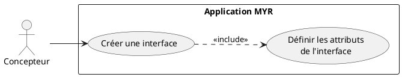
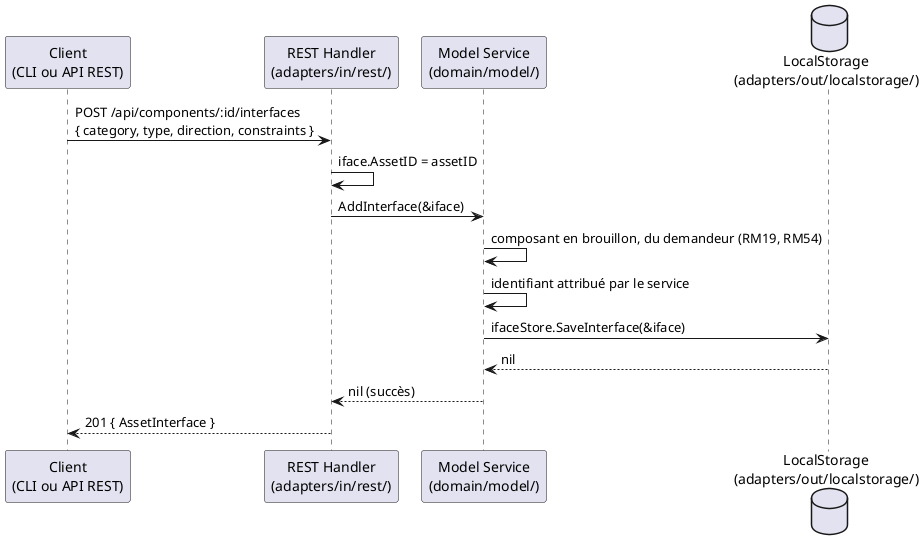

# Créer une interface sur un composant

## Diagramme d'acteurs

## Contexte

Une interface est créée explicitement, avec tous ses attributs, par `POST /api/components/:id/interfaces` ou `myr model interface add`. Le système ne déduit aucun attribut d'une autre interface et ne crée aucune liaison à cette occasion : relier l'interface à une autre est une demande distincte (UCAM01).

## Pré-conditions

- L'identité agit avec le rôle **Concepteur** (`contributor`)
- Le composant cible existe, est en brouillon et appartient à l'identité qui agit (RM54)

## Scénario

### Flux nominal — Attributs explicites

**Étape initiale :** `POST /api/components/:id/interfaces` est appelée (ou l'équivalent CLI `myr model interface add`) avec les attributs de l'interface

1. Le client transmet catégorie, sens, type et contraintes de valeur (RM53)
2. Le handler appelle `service.AddInterface(&iface)` — l'identifiant est toujours attribué par le service
3. L'interface est persistée en brouillon local dans `ifaceStore.SaveInterface()` (ADR-02) — aucune transaction Fabric tant que le composant n'est pas soumis
4. La réponse `201 Created` retourne l'interface créée

<!-- tests-obsidian:begin — tests rattachés à cette exigence, section générée : ne pas l'éditer à la main -->
> [!check]- Tests — 0 explicite(s) · 91 déduit(s)
> - 🟡 [TestRunModelInterfaceAdd_NominalCase](../../../docs/tests/adapters-in-cli/TestRunModelInterfaceAdd_NominalCase.md) — déduit : teste commande `myr model interface add`
> - 🟡 [TestRunModelInterfaceAdd_ServiceError_Rejected](../../../docs/tests/adapters-in-cli/TestRunModelInterfaceAdd_ServiceError_Rejected.md) — déduit : teste commande `myr model interface add`
> - 🟡 [TestAPIIntegration_AssetLifecycle](../../../docs/tests/adapters-in-rest/TestAPIIntegration_AssetLifecycle.md) — déduit : teste route `/api/components`
> - 🟡 [TestAPIIntegration_ConcurrentAssetCreation](../../../docs/tests/adapters-in-rest/TestAPIIntegration_ConcurrentAssetCreation.md) — déduit : teste route `/api/components`
> - 🟡 [TestAPIIntegration_InterfaceLifecycle](../../../docs/tests/adapters-in-rest/TestAPIIntegration_InterfaceLifecycle.md) — déduit : teste route `/api/components`
> - 🟡 [TestAPIIntegration_ModuleLifecycle](../../../docs/tests/adapters-in-rest/TestAPIIntegration_ModuleLifecycle.md) — déduit : teste route `/api/components`
> - 🟡 [TestComponentInterfaces_GET](../../../docs/tests/adapters-in-rest/TestComponentInterfaces_GET.md) — déduit : teste route `/api/components`
> - 🟡 [TestComponentInterfaces_POST_BadJSON](../../../docs/tests/adapters-in-rest/TestComponentInterfaces_POST_BadJSON.md) — déduit : teste route `/api/components`
> - 🟡 [TestComponentInterfaces_POST_Created](../../../docs/tests/adapters-in-rest/TestComponentInterfaces_POST_Created.md) — déduit : teste route `/api/components`
> - 🟡 [TestComponentTree_GET](../../../docs/tests/adapters-in-rest/TestComponentTree_GET.md) — déduit : teste route `/api/components`
> - 🟡 [TestComponentTree_MethodNotAllowed](../../../docs/tests/adapters-in-rest/TestComponentTree_MethodNotAllowed.md) — déduit : teste route `/api/components`
> - 🟡 [TestComponent_AddAssembly](../../../docs/tests/adapters-in-rest/TestComponent_AddAssembly.md) — déduit : teste route `/api/components`
> - 🟡 [TestComponent_AddAssembly_MissingConnectionID](../../../docs/tests/adapters-in-rest/TestComponent_AddAssembly_MissingConnectionID.md) — déduit : teste route `/api/components`
> - 🟡 [TestComponent_AddInstance](../../../docs/tests/adapters-in-rest/TestComponent_AddInstance.md) — déduit : teste route `/api/components`
> - 🟡 [TestComponent_AddInstance_MissingAssetID](../../../docs/tests/adapters-in-rest/TestComponent_AddInstance_MissingAssetID.md) — déduit : teste route `/api/components`
> - … et 76 autre(s) : voir la [matrice de couverture](../../../docs/tests/Matrice_Couverture_Tests.md)
<!-- tests-obsidian:end -->

### Flux erreur — Composant introuvable, soumis ou d'une autre identité

1. Le composant n'existe pas (`404`), est déjà soumis (`409`, RM19) ou appartient à une autre identité (`403`, RM54)
2. Aucune interface n'est créée

<!-- tests-obsidian:begin — tests rattachés à cette exigence, section générée : ne pas l'éditer à la main -->
> [!warning] Tests — aucun test ne couvre cette exigence
> [Matrice de couverture](../../../docs/tests/Matrice_Couverture_Tests.md)
<!-- tests-obsidian:end -->

### Flux erreur — Unité inconnue

1. Une contrainte porte une unité inconnue, même après lecture d'un préfixe SI usuel (RM53)
2. La requête est refusée (`400`) ; aucune interface n'est créée

<!-- tests-obsidian:begin — tests rattachés à cette exigence, section générée : ne pas l'éditer à la main -->
> [!warning] Tests — aucun test ne couvre cette exigence
> [Matrice de couverture](../../../docs/tests/Matrice_Couverture_Tests.md)
<!-- tests-obsidian:end -->

## Post-conditions

- Une nouvelle interface est enregistrée en brouillon local sur le composant (ADR-02)
- Aucune liaison n'est créée
- Aucune transaction blockchain n'est émise — l'interface rejoindra le ledger à la soumission du composant

## Diagramme de séquence

## Règles métier déclenchées

| Règle | Description |
|-------|-------------|
| **RM19** | Un asset soumis est figé : aucune interface ne s'y ajoute |
| **RM53** | Unité de chaque contrainte lue dans le vocabulaire, sinon préfixe SI usuel + unité connue, sinon refusée |
| **RM54** | Seul le propriétaire du composant y ajoute une interface |

## Exigences non-fonctionnelles

- **ENF12** — Création d'interface réservée au rôle `contributor` côté serveur
- **ENF18** — `domain/model/service.go` ne doit pas importer Fabric ou SQLite
- Temps de réponse `POST /api/components/:id/interfaces` : `< 200 ms` (opération locale tant que le composant est en brouillon)

## Notes d'implémentation

**Route :** `POST /api/components/:id/interfaces` → `handleComponentInterfaces()` case `MethodPost`. Le handler extrait `assetID` du path et appelle `service.AddInterface()`. Aucune vérification de compatibilité n'est faite ici (l'interface est ajoutée sans liaison).

**Commande CLI équivalente :** `myr model interface add <assetID> --category --type --direction [--value-min --value-max --unit] [--name <label>]` (voir `DC_CLI_Model.md` § 3.2), qui appelle `ModelService.AddInterface(&iface)` — la même méthode que le handler REST.

<!-- liens-obsidian:begin — section de traçabilité générée à partir des références du document : ne pas l'éditer à la main -->
## Liens

**Étape suivante — conception**
- **API_REST** : [§ 4. D3/D4/D6 — Composants (ressource unique, ADR-11)](../../3-Conception/API_REST.md#4.%20D3/D4/D6%20—%20Composants%20%28ressource%20unique,%20ADR-11%29)
- **Architecture_Composition** : [§ Architecture — Composition (D3/D5/D6 : composant, assemblage, module)](../../3-Conception/Architecture_Composition.md#Architecture%20—%20Composition%20%28D3/D5/D6%20:%20composant,%20assemblage,%20module%29) · [§ 3. Diagramme d'états — Model3D](../../3-Conception/Architecture_Composition.md#3.%20Diagramme%20d'états%20—%20Model3D)
- **Conception_intro** : [§ ADR-02 — Interfaces enregistrées sur la blockchain via le cycle brouillon → soumission (généralisé à tout asset)](../../3-Conception/Conception_intro.md#ADR-02%20—%20Interfaces%20enregistrées%20sur%20la%20blockchain%20via%20le%20cycle%20brouillon%20→%20soumission%20%28généralisé%20à%20tout%20asset%29)
- **DC_CLI_Model** : [§ DC — CLI Modèle : Référence des commandes composant / interfaces / module](../../3-Conception/DC_CLI_Model.md#DC%20—%20CLI%20Modèle%20:%20Référence%20des%20commandes%20composant%20/%20interfaces%20/%20module) · [§ 2. Arbre de commandes](../../3-Conception/DC_CLI_Model.md#2.%20Arbre%20de%20commandes) · [§ 3.1 `myr model add`](../../3-Conception/DC_CLI_Model.md#3.1%20`myr%20model%20add`) · [§ 3.2 `myr model interface add`](../../3-Conception/DC_CLI_Model.md#3.2%20`myr%20model%20interface%20add`) · [§ 5. Table de correspondance méthode domaine → commande CLI → use case](../../3-Conception/DC_CLI_Model.md#5.%20Table%20de%20correspondance%20méthode%20domaine%20→%20commande%20CLI%20→%20use%20case)
- **Sequence_soumission_asset** : [§ 3. Chemin brouillon — `draft: true` puis `Submit` (E8)](../../3-Conception/Sequence_soumission_asset.md#3.%20Chemin%20brouillon%20—%20`draft:%20true`%20puis%20`Submit`%20%28E8%29)
- **Tracabilite** : [§ 4.1 Citations relevées dans les specs](../../3-Conception/Tracabilite.md#4.1%20Citations%20relevées%20dans%20les%20specs)

<!-- liens-obsidian:end -->
