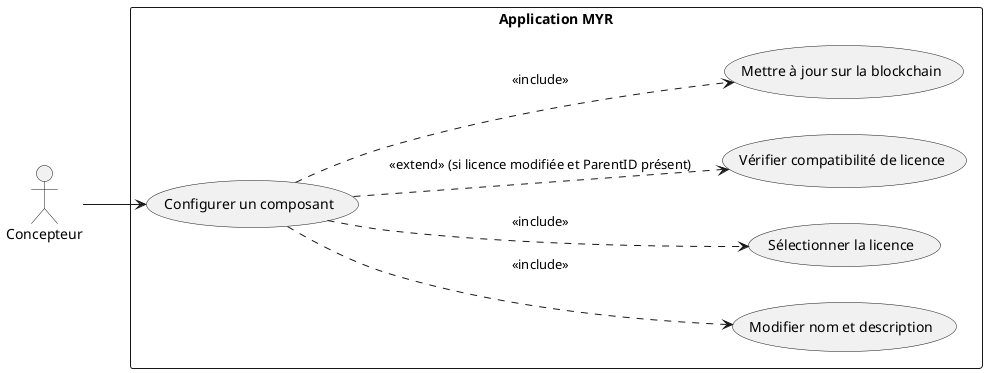
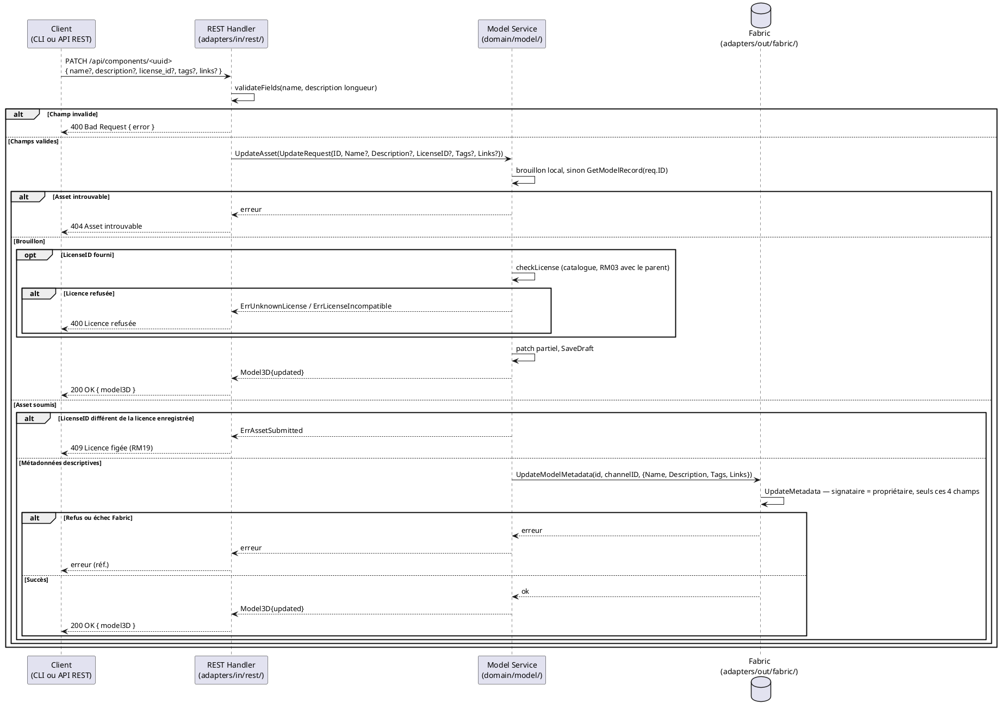
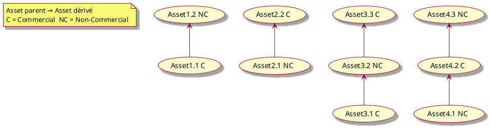

# Configurer un Composant

## Diagramme d'acteurs

## Contexte

Un composant peut être reconfiguré par son propriétaire. Cette opération ne modifie jamais le fichier 3D ni son empreinte. Ce qui peut changer dépend de l'état du composant (RM19) :

| État | Champs modifiables | Où la modification est enregistrée |
|------|--------------------|------------------------------------|
| Brouillon (`draft`) | nom, description, licence, tags, liens | brouillon local (`DraftStore`) — aucune transaction |
| Soumis (`submitted`) | nom, description, tags, liens — **la licence est figée** | ledger, par l'opération dédiée `UpdateMetadata` (`BlockchainPort.UpdateModelMetadata`), signée par le propriétaire ; aucun autre champ de l'enregistrement ne change (ADR-12) |

Cette opération est généralisée à tout asset, y compris un module (voir UCMOD03) : même service `UpdateAsset()`, mêmes champs, mêmes contrôles, seule la route change (`PATCH /api/modules/:id`, alias de `PATCH /api/components/:id`).

**Contrainte clé :** une licence proposée doit exister dans le catalogue et, si l'asset a un `ParentID`, être compatible avec la licence du parent (RM03) — `UpdateAsset()` applique ces vérifications comme `AddFull()` à la création.

## Pré-conditions

- Le Concepteur est authentifié avec le rôle `contributor` (session REST valide).
- L'asset existe sur le canal Fabric et son ID est connu.
- Le Concepteur est propriétaire de l'asset (`OwnerID` correspond à son identité).

## Scénario

**Étape initiale :** `PATCH /api/components/<uuid>` est appelée (ou l'équivalent CLI `myr model update`) avec un ou plusieurs champs à modifier

### Flux nominal — Configuration réussie

1. Un ou plusieurs champs sont transmis : nom, description, licence, tags, liens (JSON body ou form).
2. Le REST Handler valide les champs (name max 256, description max 10000, IDs valides).
3. Le handler appelle `service.UpdateAsset(UpdateRequest{ID, Name, Description, LicenseID, Tags, Links})`.
4. Le service récupère l'asset : brouillon local d'abord, sinon enregistrement du ledger.
5. **Brouillon :** si `LicenseID` est fourni, le service vérifie qu'il existe au catalogue et qu'il est compatible avec la licence du parent (RM03) ; il applique le patch partiel (seuls les champs non vides écrasent les valeurs actuelles) et enregistre le brouillon.
6. **Asset soumis :** le service applique le patch partiel au nom, à la description, aux tags et aux liens, puis appelle `blockchain.UpdateModelMetadata(id, channelID, AssetMetadata{...})` ; le chaincode vérifie que le signataire est le propriétaire et ne remplace que ces quatre champs.
7. L'API retourne `200 OK` avec le `Model3D` mis à jour.

<!-- tests-obsidian:begin — tests rattachés à cette exigence, section générée : ne pas l'éditer à la main -->
> [!check]- Tests — 0 explicite(s) · 7 déduit(s)
> - 🟡 [TestFabricBlockchain_UpdateModelMetadata](../../../docs/tests/adapters-out-fabric/TestFabricBlockchain_UpdateModelMetadata.md) — déduit : teste `BlockchainPort.UpdateModelMetadata`
> - 🟡 [TestIntegration_UpdateMetadata_OwnerOnly](../../../docs/tests/adapters-out-fabric/TestIntegration_UpdateMetadata_OwnerOnly.md) — déduit : teste `BlockchainPort.UpdateModelMetadata`
> - 🟡 [TestLicense_UnknownLicense_Rejected](../../../docs/tests/domain-model/TestLicense_UnknownLicense_Rejected.md) — déduit : teste `ModelService.UpdateAsset`
> - 🟡 [TestUpdateAsset_Draft_StaysLocal](../../../docs/tests/domain-model/TestUpdateAsset_Draft_StaysLocal.md) — déduit : teste `ModelService.UpdateAsset`
> - 🟡 [TestUpdateAsset_RM03_IncompatibleLicense_Rejected](../../../docs/tests/domain-model/TestUpdateAsset_RM03_IncompatibleLicense_Rejected.md) — déduit : teste `ModelService.UpdateAsset`
> - 🟡 [TestUpdateAsset_RM19_SubmittedLicense_Rejected](../../../docs/tests/domain-model/TestUpdateAsset_RM19_SubmittedLicense_Rejected.md) — déduit : teste `ModelService.UpdateAsset`
> - 🟡 [TestUpdateAsset_SubmittedMetadata_UpdatedOnLedger](../../../docs/tests/domain-model/TestUpdateAsset_SubmittedMetadata_UpdatedOnLedger.md) — déduit : teste `ModelService.UpdateAsset`
<!-- tests-obsidian:end -->

### Flux alternatif — Patch partiel (mise à jour d'un seul champ)

1. Un seul champ est transmis (ex. : la licence d'un brouillon passe de CC BY à CC BY-SA, ou le lien d'un composant soumis change d'adresse).
2. Le service applique uniquement ce champ — les autres restent inchangés (`UpdateAsset` est un patch partiel).
3. Une licence est vérifiée (catalogue, RM03) ; un lien d'asset soumis est enregistré par `UpdateMetadata`.

<!-- tests-obsidian:begin — tests rattachés à cette exigence, section générée : ne pas l'éditer à la main -->
> [!check]- Tests — 0 explicite(s) · 5 déduit(s)
> - 🟡 [TestLicense_UnknownLicense_Rejected](../../../docs/tests/domain-model/TestLicense_UnknownLicense_Rejected.md) — déduit : teste `ModelService.UpdateAsset`
> - 🟡 [TestUpdateAsset_Draft_StaysLocal](../../../docs/tests/domain-model/TestUpdateAsset_Draft_StaysLocal.md) — déduit : teste `ModelService.UpdateAsset`
> - 🟡 [TestUpdateAsset_RM03_IncompatibleLicense_Rejected](../../../docs/tests/domain-model/TestUpdateAsset_RM03_IncompatibleLicense_Rejected.md) — déduit : teste `ModelService.UpdateAsset`
> - 🟡 [TestUpdateAsset_RM19_SubmittedLicense_Rejected](../../../docs/tests/domain-model/TestUpdateAsset_RM19_SubmittedLicense_Rejected.md) — déduit : teste `ModelService.UpdateAsset`
> - 🟡 [TestUpdateAsset_SubmittedMetadata_UpdatedOnLedger](../../../docs/tests/domain-model/TestUpdateAsset_SubmittedMetadata_UpdatedOnLedger.md) — déduit : teste `ModelService.UpdateAsset`
<!-- tests-obsidian:end -->

### Flux erreur — Incompatibilité de licence avec le parent (RM03)

1. L'asset est un brouillon dérivé (`ParentID`) et la nouvelle licence est incompatible avec la licence du parent — ou la licence est absente du catalogue.
2. `CheckLicenseCompatibility(parent.LicenseID, newLicenseID)` retourne `Compatible: false` (`ErrLicenseIncompatible`), ou `GetLicense` échoue (`ErrUnknownLicense`).
3. Le service retourne l'erreur sans rien enregistrer.
4. L'API retourne `400 Bad Request` avec le motif.

<!-- tests-obsidian:begin — tests rattachés à cette exigence, section générée : ne pas l'éditer à la main -->
> [!warning] Tests — aucun test ne couvre cette exigence
> [Matrice de couverture](../../../docs/tests/Matrice_Couverture_Tests.md)
<!-- tests-obsidian:end -->

### Flux erreur — Changement de licence d'un composant soumis (RM19)

1. Le composant est soumis et la requête propose une licence différente de la sienne.
2. Le service refuse (`ErrAssetSubmitted`) sans rien enregistrer : la licence d'un asset soumis est figée — un changement de licence passe par un composant dérivé.
3. L'API retourne `409 Conflict`.

<!-- tests-obsidian:begin — tests rattachés à cette exigence, section générée : ne pas l'éditer à la main -->
> [!warning] Tests — aucun test ne couvre cette exigence
> [Matrice de couverture](../../../docs/tests/Matrice_Couverture_Tests.md)
<!-- tests-obsidian:end -->

### Flux erreur — Asset introuvable

1. `blockchain.GetModelRecord(req.ID, "")` retourne une erreur (ID inexistant sur le canal).
2. L'API retourne `404 Not Found` : `{ "error": "asset introuvable" }`.

<!-- tests-obsidian:begin — tests rattachés à cette exigence, section générée : ne pas l'éditer à la main -->
> [!check]- Tests — 0 explicite(s) · 12 déduit(s)
> - 🟡 [TestFabricAdapter_GetModelRecord_EvaluateError](../../../docs/tests/adapters-out-fabric/TestFabricAdapter_GetModelRecord_EvaluateError.md) — déduit : teste `BlockchainPort.GetModelRecord`
> - 🟡 [TestFabricAdapter_GetModelRecord_InvalidJSON_ReturnsEmptyModel](../../../docs/tests/adapters-out-fabric/TestFabricAdapter_GetModelRecord_InvalidJSON_ReturnsEmptyModel.md) — déduit : teste `BlockchainPort.GetModelRecord`
> - 🟡 [TestFabricAdapter_GetModelRecord_Success](../../../docs/tests/adapters-out-fabric/TestFabricAdapter_GetModelRecord_Success.md) — déduit : teste `BlockchainPort.GetModelRecord`
> - 🟡 [TestFabricBlockchain_GetModelRecord_EvaluateError](../../../docs/tests/adapters-out-fabric/TestFabricBlockchain_GetModelRecord_EvaluateError.md) — déduit : teste `BlockchainPort.GetModelRecord`
> - 🟡 [TestFabricBlockchain_GetModelRecord_InvalidJSON_ReturnsError](../../../docs/tests/adapters-out-fabric/TestFabricBlockchain_GetModelRecord_InvalidJSON_ReturnsError.md) — déduit : teste `BlockchainPort.GetModelRecord`
> - 🟡 [TestFabricBlockchain_GetModelRecord_Missing_ErrNotFound](../../../docs/tests/adapters-out-fabric/TestFabricBlockchain_GetModelRecord_Missing_ErrNotFound.md) — déduit : teste `BlockchainPort.GetModelRecord`
> - 🟡 [TestFabricBlockchain_GetModelRecord_Success](../../../docs/tests/adapters-out-fabric/TestFabricBlockchain_GetModelRecord_Success.md) — déduit : teste `BlockchainPort.GetModelRecord`
> - 🟡 [TestIntegration_GetModelRecord_NotFound](../../../docs/tests/adapters-out-fabric/TestIntegration_GetModelRecord_NotFound.md) — déduit : teste `BlockchainPort.GetModelRecord`
> - 🟡 [TestIntegration_ModelService_SubmittedAsset](../../../docs/tests/adapters-out-fabric/TestIntegration_ModelService_SubmittedAsset.md) — déduit : teste `BlockchainPort.GetModelRecord`
> - 🟡 [TestIntegration_RM06_WriteOnce](../../../docs/tests/adapters-out-fabric/TestIntegration_RM06_WriteOnce.md) — déduit : teste `BlockchainPort.GetModelRecord`
> - 🟡 [TestIntegration_StoreAndGet_UserSigned](../../../docs/tests/adapters-out-fabric/TestIntegration_StoreAndGet_UserSigned.md) — déduit : teste `BlockchainPort.GetModelRecord`
> - 🟡 [TestIntegration_UpdateMetadata_OwnerOnly](../../../docs/tests/adapters-out-fabric/TestIntegration_UpdateMetadata_OwnerOnly.md) — déduit : teste `BlockchainPort.GetModelRecord`
<!-- tests-obsidian:end -->

### Flux erreur — Échec endorsement Fabric

1. `blockchain.UpdateModelMetadata(...)` retourne une erreur Fabric — notamment si le signataire n'est pas le propriétaire de l'asset.
2. L'enregistrement du ledger reste inchangé.
3. L'API retourne une erreur avec sa référence (`503` si le réseau est indisponible).

<!-- tests-obsidian:begin — tests rattachés à cette exigence, section générée : ne pas l'éditer à la main -->
> [!check]- Tests — 0 explicite(s) · 2 déduit(s)
> - 🟡 [TestFabricBlockchain_UpdateModelMetadata](../../../docs/tests/adapters-out-fabric/TestFabricBlockchain_UpdateModelMetadata.md) — déduit : teste `BlockchainPort.UpdateModelMetadata`
> - 🟡 [TestIntegration_UpdateMetadata_OwnerOnly](../../../docs/tests/adapters-out-fabric/TestIntegration_UpdateMetadata_OwnerOnly.md) — déduit : teste `BlockchainPort.UpdateModelMetadata`
<!-- tests-obsidian:end -->

## Post-conditions

- Brouillon : le brouillon local porte les nouvelles valeurs ; rien n'est écrit sur le ledger avant la soumission.
- Asset soumis : les métadonnées descriptives mises à jour sont inscrites sur le ledger ; l'historique des modifications reste traçable par les transactions successives, et tous les autres champs de l'enregistrement sont inchangés.
- Les informations mises à jour sont visibles par les autres utilisateurs du réseau.

## Diagramme de séquence

## Règles métier déclenchées

| Règle | Description |
|-------|-------------|
| **RM03** | Si `ParentID != ""` et `LicenseID` modifié : re-vérification de compatibilité de licence obligatoire |
| **RM07** | Validation complète côté serveur avant toute soumission blockchain |

### Héritage de licences Commercial / Non-Commercial

La compatibilité de licence suit ces règles :
- Un asset Commercial peut dériver d'un asset Non-Commercial (si la licence du parent l'autorise).
- Un asset Non-Commercial peut dériver d'un asset Commercial.
- La compatibilité exacte dépend du catalogue de licences (`ListLicenses()` / `CheckLicenseCompatibility()`).

## Exigences non-fonctionnelles

| ID | Exigence |
|----|---------|
| **EF12** | La configuration d'un composant (nom, licence) est modifiable par son propriétaire |
| **ENF12** | Contrôle du rôle `contributor` côté serveur avant toute écriture |
| **ENF30** | En cas d'échec blockchain, l'état du composant reste celui du dernier enregistrement valide |

## Notes d'implémentation

**Route :** `PATCH /api/components/:id` → `handler.patchComponent()` → `service.UpdateAsset()` → `DraftStore.SaveDraft()` (brouillon) ou `BlockchainPort.UpdateModelMetadata()` (asset soumis, fonction chaincode `UpdateMetadata`).

**Commande CLI équivalente :** `myr model update <id> --description <texte> --license <id> --tags <a,b>` (voir `specs/3-Conception/DC_CLI_Model.md` § 5), appelant la même méthode `service.UpdateAsset(UpdateRequest{...})` que le handler REST `updateAsset()`, avec le même comportement de patch partiel et la même vérification de compatibilité de licence (RM03).

**Patch partiel :** `service.UpdateAsset()` applique uniquement les champs non-vides de `UpdateRequest`. Les champs `Tags` et `Links` sont des slices — si `nil`, ils ne sont pas écrasés ; si `[]string{}` (slice vide), ils effacent les valeurs existantes.

**Vérification de licence :** une seule fonction du domaine (`checkLicense`) contrôle la licence proposée à la création (`AddFull`, `CreateModule`) comme en modification (`UpdateAsset`) : présence au catalogue (`GetLicense`), puis compatibilité avec la licence du parent s'il est connu (RM03).

**Catalogue de licences :** `service.ListLicenses()` et `service.GetLicense(id)` (`domain/model/`), exposés par `GET /api/licenses` et `GET /api/licenses/{id}`.

<!-- liens-obsidian:begin — section de traçabilité générée à partir des références du document : ne pas l'éditer à la main -->
## Liens

**Étape suivante — conception**
- **API_REST** : [§ 4. D3/D4/D6 — Composants (ressource unique, ADR-11)](../../3-Conception/API_REST.md#4.%20D3/D4/D6%20—%20Composants%20%28ressource%20unique,%20ADR-11%29)
- **Architecture_Composition** : [§ Architecture — Composition (D3/D5/D6 : composant, assemblage, module)](../../3-Conception/Architecture_Composition.md#Architecture%20—%20Composition%20%28D3/D5/D6%20:%20composant,%20assemblage,%20module%29)
- **Chaincode** : [§ 4. Fonctions chaincode — Store/Read (D3/D4/D6)](../../3-Conception/Chaincode.md#4.%20Fonctions%20chaincode%20—%20Store/Read%20%28D3/D4/D6%29)
- **DC_CLI_Model** : [§ DC — CLI Modèle : Référence des commandes composant / interfaces / module](../../3-Conception/DC_CLI_Model.md#DC%20—%20CLI%20Modèle%20:%20Référence%20des%20commandes%20composant%20/%20interfaces%20/%20module) · [§ 2. Arbre de commandes](../../3-Conception/DC_CLI_Model.md#2.%20Arbre%20de%20commandes) · [§ 5. Table de correspondance méthode domaine → commande CLI → use case](../../3-Conception/DC_CLI_Model.md#5.%20Table%20de%20correspondance%20méthode%20domaine%20→%20commande%20CLI%20→%20use%20case)

<!-- liens-obsidian:end -->
