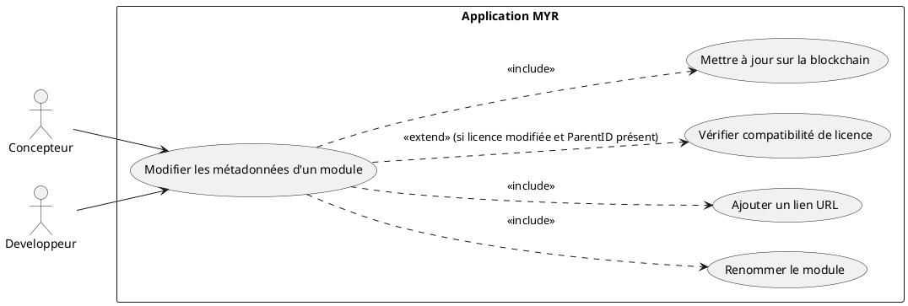
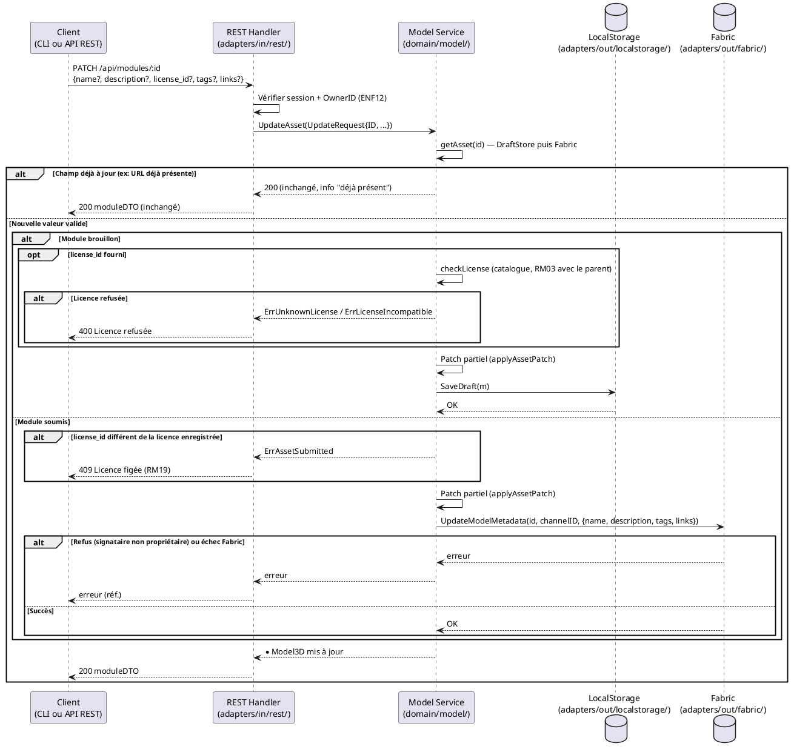

# Modifier les métadonnées d'un Module

## Diagramme d'acteurs

## Contexte

Après création, un module peut être reconfiguré par son propriétaire : nom, description, licence, tags, ou ajout d'une URL de référence (fiche produit boutique, documentation technique, dépôt GitHub, page fabricant). Cette opération ne modifie ni la composition (instances, liaisons — voir UCAM01/UCMOD02) ni le fichier associé — elle met à jour les métadonnées de l'asset.

Un module reçoit un nom généré automatiquement à sa création (`<identité du Concepteur>_<date>_<heure>`, voir UCMOD01) — le renommer est l'usage le plus courant de cet UC.

Cette opération est la généralisation à un module de UCCE02 (« Configurer un Composant ») : même service `service.UpdateAsset()`, mêmes champs modifiables (`name`, `description`, `license_id`, `tags`, `links`), même comportement de patch partiel, seule la route change (`PATCH /api/modules/:id` au lieu de `PATCH /api/components/:id`). Seul le propriétaire du Module (`OwnerID`) peut modifier ses métadonnées.

**Brouillon ou soumis (RM19) :** tant que le Module est en brouillon, tous ces champs se modifient localement, sans transaction blockchain. Une fois soumis, le Module est figé : sa composition, sa licence, son parent et son propriétaire ne changent plus — les faire évoluer passe par un module dérivé (UCMOD01, dérivation). Seules ses métadonnées descriptives (`name`, `description`, `tags`, `links`) restent modifiables par son propriétaire, via l'opération dédiée `UpdateMetadata` du chaincode, qui n'accepte aucun autre champ.

## Pré-conditions

- Utilisateur authentifié avec rôle **Concepteur** ou **Développeur**
- Être propriétaire du Module (`OwnerID == userID`)
- Le Module existe (brouillon local ou soumis sur la blockchain)
- Si une URL est fournie : elle est syntaxiquement valide (format HTTP/HTTPS)

## Scénario

**Étape initiale :** `PATCH /api/modules/:id` est appelée (ou l'équivalent CLI `myr model update`) avec un ou plusieurs champs à modifier

### Flux nominal — Renommage du module

1. Un nouveau nom est transmis : `{name: "Chassis v2"}`
2. Le REST Handler valide le champ (name max 256 caractères)
3. Le handler appelle `service.UpdateAsset(UpdateRequest{ID, Name})`
4. Le service récupère l'asset existant (brouillon ou blockchain) et applique le patch partiel — seul `Name` change
5. Si le module est un brouillon : la modification reste locale (`DraftStore`), aucune transaction blockchain
6. Si le module est déjà soumis : la mise à jour des métadonnées descriptives est soumise au ledger (`UpdateModelMetadata` → chaincode `UpdateMetadata`, qui vérifie que le signataire est le propriétaire)
7. L'API retourne `200 OK` avec le `Model3D` mis à jour

<!-- tests-obsidian:begin — tests rattachés à cette exigence, section générée : ne pas l'éditer à la main -->
> [!check]- Tests — 0 explicite(s) · 9 déduit(s)
> - 🟡 [TestFabricBlockchain_UpdateModelMetadata](../../../docs/tests/adapters-out-fabric/TestFabricBlockchain_UpdateModelMetadata.md) — déduit : teste `BlockchainPort.UpdateModelMetadata`
> - 🟡 [TestIntegration_UpdateMetadata_OwnerOnly](../../../docs/tests/adapters-out-fabric/TestIntegration_UpdateMetadata_OwnerOnly.md) — déduit : teste `BlockchainPort.UpdateModelMetadata`
> - 🟡 [TestLicense_UnknownLicense_Rejected](../../../docs/tests/domain-model/TestLicense_UnknownLicense_Rejected.md) — déduit : teste `ModelService.UpdateAsset`
> - 🟡 [TestOwnership_RM54_CreatorIsOwner](../../../docs/tests/domain-model/TestOwnership_RM54_CreatorIsOwner.md) — déduit : teste `ModelService.UpdateAsset`
> - 🟡 [TestOwnership_RM54_SubmittedMetadata_OtherIdentity_Rejected](../../../docs/tests/domain-model/TestOwnership_RM54_SubmittedMetadata_OtherIdentity_Rejected.md) — déduit : teste `ModelService.UpdateAsset`
> - 🟡 [TestUpdateAsset_Draft_StaysLocal](../../../docs/tests/domain-model/TestUpdateAsset_Draft_StaysLocal.md) — déduit : teste `ModelService.UpdateAsset`
> - 🟡 [TestUpdateAsset_RM03_IncompatibleLicense_Rejected](../../../docs/tests/domain-model/TestUpdateAsset_RM03_IncompatibleLicense_Rejected.md) — déduit : teste `ModelService.UpdateAsset`
> - 🟡 [TestUpdateAsset_RM19_SubmittedLicense_Rejected](../../../docs/tests/domain-model/TestUpdateAsset_RM19_SubmittedLicense_Rejected.md) — déduit : teste `ModelService.UpdateAsset`
> - 🟡 [TestUpdateAsset_SubmittedMetadata_UpdatedOnLedger](../../../docs/tests/domain-model/TestUpdateAsset_SubmittedMetadata_UpdatedOnLedger.md) — déduit : teste `ModelService.UpdateAsset`
<!-- tests-obsidian:end -->

### Flux nominal — URL ajoutée avec succès

1. L'URL de référence est transmise : `{links: [...existant, nouvelleURL]}`
2. Le service valide le format (doit commencer par `http://` ou `https://`)
3. Service : `UpdateAsset(UpdateRequest{ID, Links: [...]})` — patch partiel
4. Si le module est déjà soumis, l'adapter blockchain met à jour ses métadonnées descriptives (`UpdateModelMetadata`)
5. La réponse confirme — l'URL apparaît dans la liste des liens du Module

<!-- tests-obsidian:begin — tests rattachés à cette exigence, section générée : ne pas l'éditer à la main -->
> [!check]- Tests — 0 explicite(s) · 9 déduit(s)
> - 🟡 [TestFabricBlockchain_UpdateModelMetadata](../../../docs/tests/adapters-out-fabric/TestFabricBlockchain_UpdateModelMetadata.md) — déduit : teste `BlockchainPort.UpdateModelMetadata`
> - 🟡 [TestIntegration_UpdateMetadata_OwnerOnly](../../../docs/tests/adapters-out-fabric/TestIntegration_UpdateMetadata_OwnerOnly.md) — déduit : teste `BlockchainPort.UpdateModelMetadata`
> - 🟡 [TestLicense_UnknownLicense_Rejected](../../../docs/tests/domain-model/TestLicense_UnknownLicense_Rejected.md) — déduit : teste `ModelService.UpdateAsset`
> - 🟡 [TestOwnership_RM54_CreatorIsOwner](../../../docs/tests/domain-model/TestOwnership_RM54_CreatorIsOwner.md) — déduit : teste `ModelService.UpdateAsset`
> - 🟡 [TestOwnership_RM54_SubmittedMetadata_OtherIdentity_Rejected](../../../docs/tests/domain-model/TestOwnership_RM54_SubmittedMetadata_OtherIdentity_Rejected.md) — déduit : teste `ModelService.UpdateAsset`
> - 🟡 [TestUpdateAsset_Draft_StaysLocal](../../../docs/tests/domain-model/TestUpdateAsset_Draft_StaysLocal.md) — déduit : teste `ModelService.UpdateAsset`
> - 🟡 [TestUpdateAsset_RM03_IncompatibleLicense_Rejected](../../../docs/tests/domain-model/TestUpdateAsset_RM03_IncompatibleLicense_Rejected.md) — déduit : teste `ModelService.UpdateAsset`
> - 🟡 [TestUpdateAsset_RM19_SubmittedLicense_Rejected](../../../docs/tests/domain-model/TestUpdateAsset_RM19_SubmittedLicense_Rejected.md) — déduit : teste `ModelService.UpdateAsset`
> - 🟡 [TestUpdateAsset_SubmittedMetadata_UpdatedOnLedger](../../../docs/tests/domain-model/TestUpdateAsset_SubmittedMetadata_UpdatedOnLedger.md) — déduit : teste `ModelService.UpdateAsset`
<!-- tests-obsidian:end -->

### Flux alternatif — Patch partiel (un seul champ à la fois)

1. Seul un champ est transmis (nom, description, licence, tags ou liens)
2. Le service applique uniquement ce champ — les autres restent inchangés (`UpdateAsset` est un patch partiel)
3. Si `license_id` est fourni pour un module en brouillon : la licence doit exister dans le catalogue et, si le module a un `ParentID`, être compatible avec celle du parent (RM03)

<!-- tests-obsidian:begin — tests rattachés à cette exigence, section générée : ne pas l'éditer à la main -->
> [!check]- Tests — 0 explicite(s) · 7 déduit(s)
> - 🟡 [TestLicense_UnknownLicense_Rejected](../../../docs/tests/domain-model/TestLicense_UnknownLicense_Rejected.md) — déduit : teste `ModelService.UpdateAsset`
> - 🟡 [TestOwnership_RM54_CreatorIsOwner](../../../docs/tests/domain-model/TestOwnership_RM54_CreatorIsOwner.md) — déduit : teste `ModelService.UpdateAsset`
> - 🟡 [TestOwnership_RM54_SubmittedMetadata_OtherIdentity_Rejected](../../../docs/tests/domain-model/TestOwnership_RM54_SubmittedMetadata_OtherIdentity_Rejected.md) — déduit : teste `ModelService.UpdateAsset`
> - 🟡 [TestUpdateAsset_Draft_StaysLocal](../../../docs/tests/domain-model/TestUpdateAsset_Draft_StaysLocal.md) — déduit : teste `ModelService.UpdateAsset`
> - 🟡 [TestUpdateAsset_RM03_IncompatibleLicense_Rejected](../../../docs/tests/domain-model/TestUpdateAsset_RM03_IncompatibleLicense_Rejected.md) — déduit : teste `ModelService.UpdateAsset`
> - 🟡 [TestUpdateAsset_RM19_SubmittedLicense_Rejected](../../../docs/tests/domain-model/TestUpdateAsset_RM19_SubmittedLicense_Rejected.md) — déduit : teste `ModelService.UpdateAsset`
> - 🟡 [TestUpdateAsset_SubmittedMetadata_UpdatedOnLedger](../../../docs/tests/domain-model/TestUpdateAsset_SubmittedMetadata_UpdatedOnLedger.md) — déduit : teste `ModelService.UpdateAsset`
<!-- tests-obsidian:end -->

### Flux alternatif — Module en état draft

1. Le Module est encore en état `draft` (non soumis)
2. La mise à jour s'effectue de la même façon via `UpdateAsset()`, mais reste dans `DraftStore`
3. Aucune transaction Fabric n'est créée — la modification sera incluse dans la `ModuleVersion` lors de la soumission (UCMOD06)

<!-- tests-obsidian:begin — tests rattachés à cette exigence, section générée : ne pas l'éditer à la main -->
> [!check]- Tests — 0 explicite(s) · 7 déduit(s)
> - 🟡 [TestLicense_UnknownLicense_Rejected](../../../docs/tests/domain-model/TestLicense_UnknownLicense_Rejected.md) — déduit : teste `ModelService.UpdateAsset`
> - 🟡 [TestOwnership_RM54_CreatorIsOwner](../../../docs/tests/domain-model/TestOwnership_RM54_CreatorIsOwner.md) — déduit : teste `ModelService.UpdateAsset`
> - 🟡 [TestOwnership_RM54_SubmittedMetadata_OtherIdentity_Rejected](../../../docs/tests/domain-model/TestOwnership_RM54_SubmittedMetadata_OtherIdentity_Rejected.md) — déduit : teste `ModelService.UpdateAsset`
> - 🟡 [TestUpdateAsset_Draft_StaysLocal](../../../docs/tests/domain-model/TestUpdateAsset_Draft_StaysLocal.md) — déduit : teste `ModelService.UpdateAsset`
> - 🟡 [TestUpdateAsset_RM03_IncompatibleLicense_Rejected](../../../docs/tests/domain-model/TestUpdateAsset_RM03_IncompatibleLicense_Rejected.md) — déduit : teste `ModelService.UpdateAsset`
> - 🟡 [TestUpdateAsset_RM19_SubmittedLicense_Rejected](../../../docs/tests/domain-model/TestUpdateAsset_RM19_SubmittedLicense_Rejected.md) — déduit : teste `ModelService.UpdateAsset`
> - 🟡 [TestUpdateAsset_SubmittedMetadata_UpdatedOnLedger](../../../docs/tests/domain-model/TestUpdateAsset_SubmittedMetadata_UpdatedOnLedger.md) — déduit : teste `ModelService.UpdateAsset`
<!-- tests-obsidian:end -->

### Flux alternatif — URL déjà présente

1. L'URL saisie est identique à une URL déjà dans `m.Links`
2. Le système détecte le doublon et n'ajoute pas d'entrée dupliquée
3. Message informatif : "Ce lien est déjà associé à ce module"

<!-- tests-obsidian:begin — tests rattachés à cette exigence, section générée : ne pas l'éditer à la main -->
> [!warning] Tests — aucun test ne couvre cette exigence
> [Matrice de couverture](../../../docs/tests/Matrice_Couverture_Tests.md)
<!-- tests-obsidian:end -->

### Flux erreur — Incompatibilité de licence avec le parent (RM03)

1. Le module est en brouillon, a un `ParentID` (voir UCMOD01, dérivation) et la nouvelle licence est incompatible avec celle du parent — ou elle est absente du catalogue
2. `CheckLicenseCompatibility(parent.LicenseID, newLicenseID)` retourne `Compatible: false` (ou la licence est inconnue)
3. Le service retourne l'erreur (`ErrLicenseIncompatible` / `ErrUnknownLicense`) sans rien enregistrer
4. L'API retourne `400 Bad Request`

<!-- tests-obsidian:begin — tests rattachés à cette exigence, section générée : ne pas l'éditer à la main -->
> [!warning] Tests — aucun test ne couvre cette exigence
> [Matrice de couverture](../../../docs/tests/Matrice_Couverture_Tests.md)
<!-- tests-obsidian:end -->

### Flux erreur — Changement de licence d'un module soumis (RM19)

1. Le module est soumis et `license_id` diffère de la licence enregistrée sur le ledger
2. Le service refuse la modification (`ErrAssetSubmitted`) sans rien soumettre au ledger
3. L'API retourne `409 Conflict` — changer de licence passe par un module dérivé (UCMOD01)

<!-- tests-obsidian:begin — tests rattachés à cette exigence, section générée : ne pas l'éditer à la main -->
> [!warning] Tests — aucun test ne couvre cette exigence
> [Matrice de couverture](../../../docs/tests/Matrice_Couverture_Tests.md)
<!-- tests-obsidian:end -->

### Flux erreur — Format URL invalide

1. La chaîne transmise ne respecte pas le format HTTP/HTTPS
2. Le serveur retourne `400 Bad Request`
3. Aucune modification persistée

<!-- tests-obsidian:begin — tests rattachés à cette exigence, section générée : ne pas l'éditer à la main -->
> [!warning] Tests — aucun test ne couvre cette exigence
> [Matrice de couverture](../../../docs/tests/Matrice_Couverture_Tests.md)
<!-- tests-obsidian:end -->

### Flux erreur — Droits insuffisants

1. L'identité n'est pas propriétaire du Module (`OwnerID != userID`)
2. Le serveur retourne `403 Forbidden`
3. Message : "Vous n'êtes pas propriétaire de ce module"

<!-- tests-obsidian:begin — tests rattachés à cette exigence, section générée : ne pas l'éditer à la main -->
> [!warning] Tests — aucun test ne couvre cette exigence
> [Matrice de couverture](../../../docs/tests/Matrice_Couverture_Tests.md)
<!-- tests-obsidian:end -->

### Flux erreur — Échec transaction blockchain

1. La transaction de mise à jour échoue (réseau Fabric indisponible, endorsement refusé)
2. Message : "Impossible de mettre à jour le module — réessayez"
3. Le Module reste dans son état précédent (ENF30)

<!-- tests-obsidian:begin — tests rattachés à cette exigence, section générée : ne pas l'éditer à la main -->
> [!warning] Tests — aucun test ne couvre cette exigence
> [Matrice de couverture](../../../docs/tests/Matrice_Couverture_Tests.md)
<!-- tests-obsidian:end -->

## Post-conditions

- Brouillon : les champs modifiés (`name`, `description`, `license_id`, `tags`, `links`) sont mis à jour localement
- Module soumis : seules les métadonnées descriptives (`name`, `description`, `tags`, `links`) sont mises à jour sur le ledger (nouvelle transaction `UpdateMetadata`) ; la composition, la licence, le parent, le propriétaire et l'empreinte restent ceux de la soumission
- Le Module reste dans son état (`draft` ou `submitted`) — le statut n'est pas modifié par cet UC
- Les métadonnées mises à jour sont visibles immédiatement via `GET /api/modules/:id`

## Diagramme de séquence

## Règles métier déclenchées

| Règle | Description | Point d'application |
|-------|-------------|---------------------|
| **RM03** | Si `ParentID != ""` et `LicenseID` modifié : re-vérification de compatibilité de licence obligatoire | `UpdateAsset()` sur un brouillon, même vérification que pour un composant (UCCE02) |
| **RM07** | Validation complète côté serveur avant toute transaction blockchain | Vérification `OwnerID` + format URL |
| **RM19** | Un module soumis est immuable, hormis ses métadonnées descriptives | `UpdateAsset()` refuse un changement de licence (409) ; le chaincode `UpdateMetadata` n'accepte que `name`, `description`, `tags`, `links` et seul le propriétaire peut le signer |

## Exigences non-fonctionnelles

- **ENF12** : Contrôle d'ownership côté serveur obligatoire
- **ENF30** : En cas d'échec Fabric, état local préservé intact

## Notes d'implémentation

**Endpoints REST utilisés :**
- `PATCH /api/modules/:id` → patch partiel via `UpdateAsset()` (handlers.go — `handleModule`, méthode PATCH)

**Champs acceptés dans le body JSON :** `name`, `description`, `license_id`, `tags` (tableau), `links` (tableau) — identiques à `PATCH /api/components/:id` (UCCE02). Aucun autre champ n'est modifiable par cette route (ni `owner_id`, ni `parent_id`, ni la composition — voir UCAM01/UCMOD02 pour la composition).

**Module soumis (RM19) :** `UpdateAsset()` ne réécrit jamais l'enregistrement complet d'un module soumis. Il transmet uniquement les quatre métadonnées descriptives au port `BlockchainPort.UpdateModelMetadata`, dont l'opération chaincode `UpdateMetadata` vérifie le propriétaire et refuse tout autre champ (`specs/3-Conception/Chaincode.md`). Faire évoluer la composition ou la licence d'un module soumis passe par un module dérivé (UCMOD01).

**Routage :** `handleModule()` distingue la branche `PATCH /api/modules/:id` des branches `GET`/`DELETE` (UCMOD08) et route le patch vers `UpdateAsset`, exactement comme `handleComponent()` le fait pour `PATCH /api/components/:id` (UCCE02) — même helper de décodage partagé entre les deux routes.

**Commande CLI équivalente :** `myr model update <id> [--name <nom>] [--description <texte>] [--license <id>] [--tags <a,b>] [--add-link <url>]` appelle la même méthode de service (`UpdateAsset`) que `PATCH /api/modules/:id`, avec le même comportement de patch partiel. Voir `specs/3-Conception/DC_CLI_Model.md` § 5.

<!-- liens-obsidian:begin — section de traçabilité générée à partir des références du document : ne pas l'éditer à la main -->
## Liens

**Étape suivante — conception**
- **API_REST** : [§ 4. D3/D4/D6 — Composants (ressource unique, ADR-11)](../../3-Conception/API_REST.md#4.%20D3/D4/D6%20—%20Composants%20%28ressource%20unique,%20ADR-11%29)
- **Architecture_Composition** : [§ Architecture — Composition (D3/D5/D6 : composant, assemblage, module)](../../3-Conception/Architecture_Composition.md#Architecture%20—%20Composition%20%28D3/D5/D6%20:%20composant,%20assemblage,%20module%29)
- **Chaincode** : [§ 4. Fonctions chaincode — Store/Read (D3/D4/D6)](../../3-Conception/Chaincode.md#4.%20Fonctions%20chaincode%20—%20Store/Read%20%28D3/D4/D6%29)
- **DC_CLI_Model** : [§ DC — CLI Modèle : Référence des commandes composant / interfaces / module](../../3-Conception/DC_CLI_Model.md#DC%20—%20CLI%20Modèle%20:%20Référence%20des%20commandes%20composant%20/%20interfaces%20/%20module)
- **Sequence_soumission_module** : [§ 4. Notes](../../3-Conception/Sequence_soumission_module.md#4.%20Notes)

<!-- liens-obsidian:end -->
