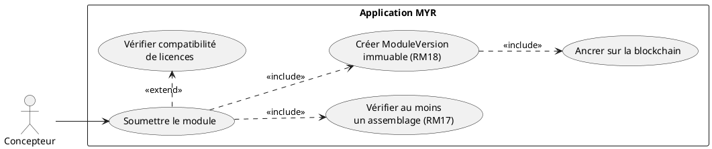
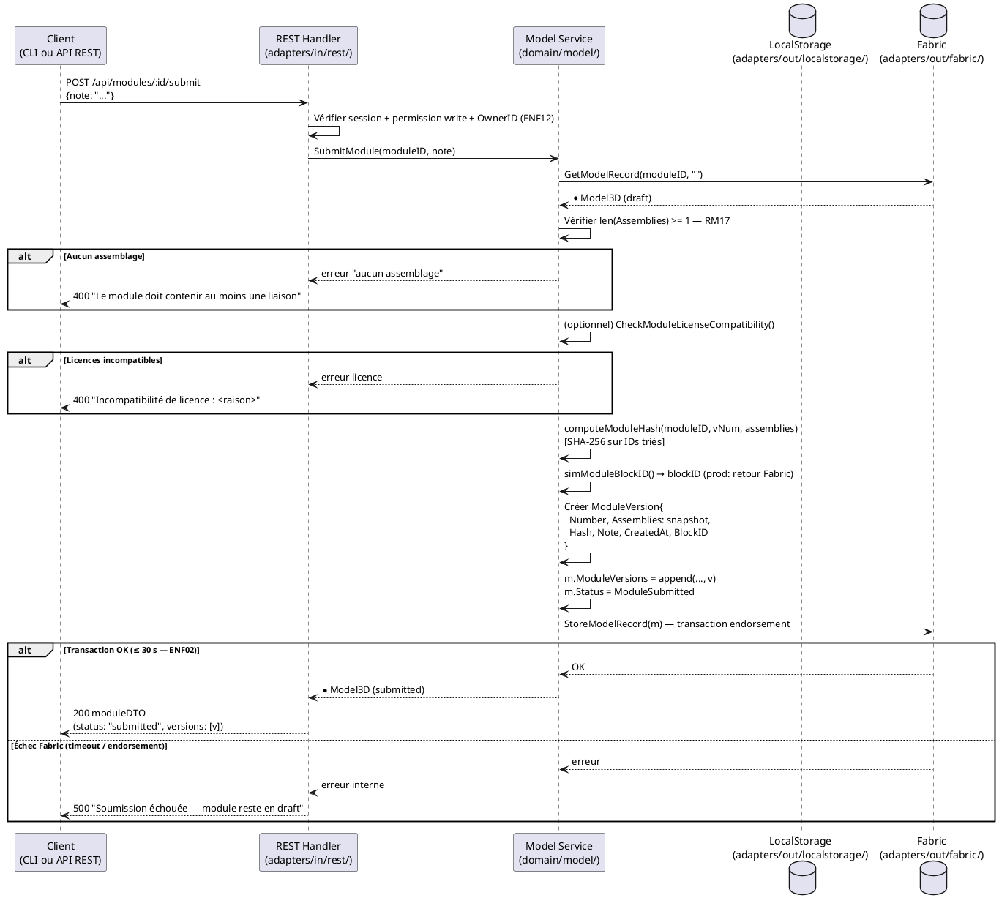

# Soumettre un module à la blockchain

## Diagramme d'acteurs

## Contexte

La soumission est l'étape **irréversible** qui fait passer un Module de l'état `draft` (local, modifiable) à l'état `submitted` (ancré blockchain, visible sur le réseau). Cette transition crée une `ModuleVersion` immuable horodatée : snapshot figé de l'assemblage avec hash SHA-256 calculé sur les IDs de connexions triés.

Une fois soumis, le Module est visible sur le réseau par tous les acteurs autorisés. Il ne peut plus être modifié directement — toute évolution nécessite la création d'une **nouvelle version** (fork — RM19). C'est la règle métier la plus critique du domaine Module.

**ENF02 :** La transaction Fabric doit se terminer en ≤ 30 secondes.
**ENF28 :** L'immuabilité blockchain est garantie — la `ModuleVersion` ne peut pas être supprimée.

## Pré-conditions

- Utilisateur authentifié avec rôle **Concepteur** (`contributor`)
- Être propriétaire du Module (`OwnerID == userID`)
- Le Module est en état **draft** (`Status == ModuleDraft`)
- Le Module contient **au moins un assemblage** (`len(m.Assemblies) >= 1`) — RM17
- La blockchain Fabric est accessible (nœuds disponibles)

## Scénario

**Étape initiale :** `POST /api/modules/:id/submit` est appelée (ou l'équivalent CLI `myr module submit`) avec une note optionnelle

### Flux nominal — Soumission réussie

1. `POST /api/modules/:id/submit` est appelée avec `{note: "..."}`
2. Service : `SubmitModule(moduleID, note)` :
   a. Vérifie `len(m.Assemblies) >= 1` (RM17) — rejet immédiat si vide
   b. Calcule le hash SHA-256 : `computeModuleHash(m.ID, vNum, m.Assemblies)` — tri déterministe des IDs
   c. Génère un `blockID` simulé (production : retour Fabric)
   d. Crée la `ModuleVersion` : `{Number, Assemblies: snapshot, Hash, Note, CreatedAt, BlockID}`
   e. Ajoute la version à `m.ModuleVersions`
   f. Met à jour `m.Status = ModuleSubmitted`
   g. Appelle `blockchain.StoreModelRecord(m)` — transaction Fabric
3. La transaction Fabric est soumise (endorsement, orderer, commit) — ≤ 30 s (ENF02)
4. La réponse confirme : "Module soumis — Version N ancrée"
5. Le Module passe en lecture seule (RM19)

<!-- tests-obsidian:begin — tests rattachés à cette exigence, section générée : ne pas l'éditer à la main -->
> [!check]- Tests — 0 explicite(s) · 31 déduit(s)
> - 🟡 [TestLegacyModulesAlias_GET_DelegatesToComponents](../../../docs/tests/adapters-in-rest/TestLegacyModulesAlias_GET_DelegatesToComponents.md) — déduit : teste route `/api/modules`
> - 🟡 [TestLegacyModulesAlias_ListRoute](../../../docs/tests/adapters-in-rest/TestLegacyModulesAlias_ListRoute.md) — déduit : teste route `/api/modules`
> - 🟡 [TestModules_RegenerateThumbnail_OK](../../../docs/tests/adapters-in-rest/TestModules_RegenerateThumbnail_OK.md) — déduit : teste route `/api/modules`
> - 🟡 [TestFabricAdapter_StoreModelRecord_SubmitError](../../../docs/tests/adapters-out-fabric/TestFabricAdapter_StoreModelRecord_SubmitError.md) — déduit : teste `BlockchainPort.StoreModelRecord`
> - 🟡 [TestFabricAdapter_StoreModelRecord_Success](../../../docs/tests/adapters-out-fabric/TestFabricAdapter_StoreModelRecord_Success.md) — déduit : teste `BlockchainPort.StoreModelRecord`
> - 🟡 [TestFabricBlockchain_StoreModelRecord_ReadOnly_Rejected](../../../docs/tests/adapters-out-fabric/TestFabricBlockchain_StoreModelRecord_ReadOnly_Rejected.md) — déduit : teste `BlockchainPort.StoreModelRecord`
> - 🟡 [TestFabricBlockchain_StoreModelRecord_SubmitError](../../../docs/tests/adapters-out-fabric/TestFabricBlockchain_StoreModelRecord_SubmitError.md) — déduit : teste `BlockchainPort.StoreModelRecord`
> - 🟡 [TestFabricBlockchain_StoreModelRecord_Success](../../../docs/tests/adapters-out-fabric/TestFabricBlockchain_StoreModelRecord_Success.md) — déduit : teste `BlockchainPort.StoreModelRecord`
> - 🟡 [TestIntegration_List](../../../docs/tests/adapters-out-fabric/TestIntegration_List.md) — déduit : teste `BlockchainPort.StoreModelRecord`
> - 🟡 [TestIntegration_ModelService_SubmittedAsset](../../../docs/tests/adapters-out-fabric/TestIntegration_ModelService_SubmittedAsset.md) — déduit : teste `BlockchainPort.StoreModelRecord`
> - 🟡 [TestIntegration_OwnerNotSigner_Rejected](../../../docs/tests/adapters-out-fabric/TestIntegration_OwnerNotSigner_Rejected.md) — déduit : teste `BlockchainPort.StoreModelRecord`
> - 🟡 [TestIntegration_PendingOrReader_Rejected](../../../docs/tests/adapters-out-fabric/TestIntegration_PendingOrReader_Rejected.md) — déduit : teste `BlockchainPort.StoreModelRecord`
> - 🟡 [TestIntegration_RM01_DuplicateHash_Rejected](../../../docs/tests/adapters-out-fabric/TestIntegration_RM01_DuplicateHash_Rejected.md) — déduit : teste `BlockchainPort.StoreModelRecord`
> - 🟡 [TestIntegration_RM05_ParentMustExist](../../../docs/tests/adapters-out-fabric/TestIntegration_RM05_ParentMustExist.md) — déduit : teste `BlockchainPort.StoreModelRecord`
> - 🟡 [TestIntegration_RM06_WriteOnce](../../../docs/tests/adapters-out-fabric/TestIntegration_RM06_WriteOnce.md) — déduit : teste `BlockchainPort.StoreModelRecord`
> - … et 16 autre(s) : voir la [matrice de couverture](../../../docs/tests/Matrice_Couverture_Tests.md)
<!-- tests-obsidian:end -->

### Flux alternatif — Module avec composants dérivés (licences parentales)

1. Le Module contient des Composants dérivés d'assets avec `ParentID` et `LicenseID`
2. Avant la soumission, le système vérifie la compatibilité de licence : `CheckModuleLicenseCompatibility(componentLicenseIDs, m.LicenseID)`
3. Toutes les licences compatibles → soumission se poursuit normalement (flux nominal à partir de l'étape 3b)
4. La `ModuleVersion` inclut la liste des dépendances de licences vérifiées

<!-- tests-obsidian:begin — tests rattachés à cette exigence, section générée : ne pas l'éditer à la main -->
> [!check]- Tests — 0 explicite(s) · 4 déduit(s)
> - 🟡 [TestCheckModuleLicense_AllCompatible](../../../docs/tests/domain-model/TestCheckModuleLicense_AllCompatible.md) — déduit : teste `ModelService.CheckModuleLicenseCompatibility`
> - 🟡 [TestCheckModuleLicense_EmptyProposed](../../../docs/tests/domain-model/TestCheckModuleLicense_EmptyProposed.md) — déduit : teste `ModelService.CheckModuleLicenseCompatibility`
> - 🟡 [TestCheckModuleLicense_Incompatible](../../../docs/tests/domain-model/TestCheckModuleLicense_Incompatible.md) — déduit : teste `ModelService.CheckModuleLicenseCompatibility`
> - 🟡 [TestCheckModuleLicense_NoComponents](../../../docs/tests/domain-model/TestCheckModuleLicense_NoComponents.md) — déduit : teste `ModelService.CheckModuleLicenseCompatibility`
<!-- tests-obsidian:end -->

### Flux alternatif — Fork d'un module déjà soumis (RM19)

1. Une modification de la composition d'un Module en état `submitted` est tentée (ajout ou retrait d'instance, ajout ou retrait de liaison, ajout d'interface…), ou une nouvelle soumission du même module
2. Le service refuse : le module n'est plus un brouillon (`ErrAssetSubmitted`) — rien n'est écrit, ni localement ni sur le ledger
3. L'API retourne `409 Conflict` : le module est publié, une nouvelle version passe par un module dérivé
4. Un module dérivé est créé explicitement : `POST /api/modules` avec `parent_id` = ID du module original (UCMOD01, dérivation)
5. Le système crée un nouveau `Model3D` en état `draft` dont la composition (instances et liaisons internes) est une copie indépendante de celle du parent
6. Le module dérivé est modifié par les mêmes actions directes que UCAM01/UCMOD01
7. Le module dérivé peut être soumis à son tour → nouvelle `ModuleVersion` indépendante, le module original restant inchangé sur le ledger

Les métadonnées descriptives d'un module soumis (`name`, `description`, `tags`, `links`) ne relèvent pas de ce flux : elles restent modifiables par leur propriétaire sans fork (UCMOD03).

<!-- tests-obsidian:begin — tests rattachés à cette exigence, section générée : ne pas l'éditer à la main -->
> [!check]- Tests — 0 explicite(s) · 3 déduit(s)
> - 🟡 [TestLegacyModulesAlias_GET_DelegatesToComponents](../../../docs/tests/adapters-in-rest/TestLegacyModulesAlias_GET_DelegatesToComponents.md) — déduit : teste route `/api/modules`
> - 🟡 [TestLegacyModulesAlias_ListRoute](../../../docs/tests/adapters-in-rest/TestLegacyModulesAlias_ListRoute.md) — déduit : teste route `/api/modules`
> - 🟡 [TestModules_RegenerateThumbnail_OK](../../../docs/tests/adapters-in-rest/TestModules_RegenerateThumbnail_OK.md) — déduit : teste route `/api/modules`
<!-- tests-obsidian:end -->

### Flux erreur — Aucun assemblage (RM17)

1. `len(m.Assemblies) == 0` détecté dans `SubmitModule()`
2. Réponse : `400 Bad Request`
3. Message : "Le module doit contenir au moins une liaison pour être soumis"
4. Le Module reste en état `draft` — des liaisons peuvent être ajoutées avant une nouvelle tentative

<!-- tests-obsidian:begin — tests rattachés à cette exigence, section générée : ne pas l'éditer à la main -->
> [!check]- Tests — 0 explicite(s) · 9 déduit(s)
> - 🟡 [TestCreateModule_ParentID_CopiesComposition](../../../docs/tests/domain-model/TestCreateModule_ParentID_CopiesComposition.md) — déduit : teste `ModelService.SubmitModule`
> - 🟡 [TestCreateModule_ParentID_RM03_LicenseIncompatible_Rejected](../../../docs/tests/domain-model/TestCreateModule_ParentID_RM03_LicenseIncompatible_Rejected.md) — déduit : teste `ModelService.SubmitModule`
> - 🟡 [TestCreateModule_RM19_ForkOfSubmitted_Submittable](../../../docs/tests/domain-model/TestCreateModule_RM19_ForkOfSubmitted_Submittable.md) — déduit : teste `ModelService.SubmitModule`
> - 🟡 [TestModule_NotFound_ReturnsError](../../../docs/tests/domain-model/TestModule_NotFound_ReturnsError.md) — déduit : teste `ModelService.SubmitModule`
> - 🟡 [TestModule_Submit](../../../docs/tests/domain-model/TestModule_Submit.md) — déduit : teste `ModelService.SubmitModule`
> - 🟡 [TestModule_Submit_NoAssembly](../../../docs/tests/domain-model/TestModule_Submit_NoAssembly.md) — déduit : teste `ModelService.SubmitModule`
> - 🟡 [TestRemoveModule_Submitted_HidesLocally](../../../docs/tests/domain-model/TestRemoveModule_Submitted_HidesLocally.md) — déduit : teste `ModelService.SubmitModule`
> - 🟡 [TestService_NilBlockchain_ErrBlockchainUnavailable](../../../docs/tests/domain-model/TestService_NilBlockchain_ErrBlockchainUnavailable.md) — déduit : teste `ModelService.SubmitModule`
> - 🟡 [TestSubmitModule_RM19_AlreadySubmitted_Rejected](../../../docs/tests/domain-model/TestSubmitModule_RM19_AlreadySubmitted_Rejected.md) — déduit : teste `ModelService.SubmitModule`
<!-- tests-obsidian:end -->

### Flux erreur — Incompatibilité de licences

1. `CheckModuleLicenseCompatibility()` retourne `Compatible: false`
2. Message détaillé : "Incompatibilité de licence entre `<composantA>` et la licence du module : `<raison>`"
3. La soumission est annulée — le Module reste en état `draft`
4. Le Concepteur doit corriger les licences avant de soumettre

<!-- tests-obsidian:begin — tests rattachés à cette exigence, section générée : ne pas l'éditer à la main -->
> [!check]- Tests — 0 explicite(s) · 4 déduit(s)
> - 🟡 [TestCheckModuleLicense_AllCompatible](../../../docs/tests/domain-model/TestCheckModuleLicense_AllCompatible.md) — déduit : teste `ModelService.CheckModuleLicenseCompatibility`
> - 🟡 [TestCheckModuleLicense_EmptyProposed](../../../docs/tests/domain-model/TestCheckModuleLicense_EmptyProposed.md) — déduit : teste `ModelService.CheckModuleLicenseCompatibility`
> - 🟡 [TestCheckModuleLicense_Incompatible](../../../docs/tests/domain-model/TestCheckModuleLicense_Incompatible.md) — déduit : teste `ModelService.CheckModuleLicenseCompatibility`
> - 🟡 [TestCheckModuleLicense_NoComponents](../../../docs/tests/domain-model/TestCheckModuleLicense_NoComponents.md) — déduit : teste `ModelService.CheckModuleLicenseCompatibility`
<!-- tests-obsidian:end -->

### Flux erreur — Échec transaction Fabric (ENF30)

1. La transaction Fabric échoue (timeout > 30 s, endorsement refusé, orderer indisponible)
2. Le service retourne une erreur
3. Message : "Soumission échouée — `<motif>` — le module reste en état draft"
4. **Aucune donnée perdue** : le Module reste en état `draft` avec tous ses assemblages (ENF30)
5. Les `ModuleVersions` partiellement créées ne sont **pas** persistées (atomicité de `StoreModelRecord`)

<!-- tests-obsidian:begin — tests rattachés à cette exigence, section générée : ne pas l'éditer à la main -->
> [!check]- Tests — 0 explicite(s) · 19 déduit(s)
> - 🟡 [TestFabricAdapter_StoreModelRecord_SubmitError](../../../docs/tests/adapters-out-fabric/TestFabricAdapter_StoreModelRecord_SubmitError.md) — déduit : teste `BlockchainPort.StoreModelRecord`
> - 🟡 [TestFabricAdapter_StoreModelRecord_Success](../../../docs/tests/adapters-out-fabric/TestFabricAdapter_StoreModelRecord_Success.md) — déduit : teste `BlockchainPort.StoreModelRecord`
> - 🟡 [TestFabricBlockchain_StoreModelRecord_ReadOnly_Rejected](../../../docs/tests/adapters-out-fabric/TestFabricBlockchain_StoreModelRecord_ReadOnly_Rejected.md) — déduit : teste `BlockchainPort.StoreModelRecord`
> - 🟡 [TestFabricBlockchain_StoreModelRecord_SubmitError](../../../docs/tests/adapters-out-fabric/TestFabricBlockchain_StoreModelRecord_SubmitError.md) — déduit : teste `BlockchainPort.StoreModelRecord`
> - 🟡 [TestFabricBlockchain_StoreModelRecord_Success](../../../docs/tests/adapters-out-fabric/TestFabricBlockchain_StoreModelRecord_Success.md) — déduit : teste `BlockchainPort.StoreModelRecord`
> - 🟡 [TestIntegration_List](../../../docs/tests/adapters-out-fabric/TestIntegration_List.md) — déduit : teste `BlockchainPort.StoreModelRecord`
> - 🟡 [TestIntegration_ModelService_SubmittedAsset](../../../docs/tests/adapters-out-fabric/TestIntegration_ModelService_SubmittedAsset.md) — déduit : teste `BlockchainPort.StoreModelRecord`
> - 🟡 [TestIntegration_OwnerNotSigner_Rejected](../../../docs/tests/adapters-out-fabric/TestIntegration_OwnerNotSigner_Rejected.md) — déduit : teste `BlockchainPort.StoreModelRecord`
> - 🟡 [TestIntegration_PendingOrReader_Rejected](../../../docs/tests/adapters-out-fabric/TestIntegration_PendingOrReader_Rejected.md) — déduit : teste `BlockchainPort.StoreModelRecord`
> - 🟡 [TestIntegration_RM01_DuplicateHash_Rejected](../../../docs/tests/adapters-out-fabric/TestIntegration_RM01_DuplicateHash_Rejected.md) — déduit : teste `BlockchainPort.StoreModelRecord`
> - 🟡 [TestIntegration_RM05_ParentMustExist](../../../docs/tests/adapters-out-fabric/TestIntegration_RM05_ParentMustExist.md) — déduit : teste `BlockchainPort.StoreModelRecord`
> - 🟡 [TestIntegration_RM06_WriteOnce](../../../docs/tests/adapters-out-fabric/TestIntegration_RM06_WriteOnce.md) — déduit : teste `BlockchainPort.StoreModelRecord`
> - 🟡 [TestIntegration_RM19_DraftRejected](../../../docs/tests/adapters-out-fabric/TestIntegration_RM19_DraftRejected.md) — déduit : teste `BlockchainPort.StoreModelRecord`
> - 🟡 [TestIntegration_RM48_WritePermissionFollowsTable](../../../docs/tests/adapters-out-fabric/TestIntegration_RM48_WritePermissionFollowsTable.md) — déduit : teste `BlockchainPort.StoreModelRecord`
> - 🟡 [TestIntegration_SharedIdentity_ChaincodeRefuses](../../../docs/tests/adapters-out-fabric/TestIntegration_SharedIdentity_ChaincodeRefuses.md) — déduit : teste `BlockchainPort.StoreModelRecord`
> - … et 4 autre(s) : voir la [matrice de couverture](../../../docs/tests/Matrice_Couverture_Tests.md)
<!-- tests-obsidian:end -->

## Post-conditions

- La `ModuleVersion` N est enregistrée de façon immuable sur la blockchain (ENF28)
- `m.Status == ModuleSubmitted`
- Le Module est visible sur le réseau pour les acteurs autorisés
- Le Module passe en lecture seule (RM19 — implémentation cible)
- Toute modification ultérieure nécessite un fork (RM19)

## Diagramme de séquence

## Règles métier déclenchées

| Règle | Description | Point d'application |
|-------|-------------|---------------------|
| **RM07** | Validation complète côté serveur avant toute transaction blockchain | Vérification ownership + RM17 avant `StoreModelRecord` |
| **RM17** | Au moins une liaison requise pour soumettre | `len(m.Assemblies) == 0` → rejet dans `SubmitModule()` |
| **RM18** | `ModuleVersion` immuable horodatée créée à la soumission | `ModuleVersion{..., CreatedAt: time.Now(), BlockID}` |
| **RM19** | Module soumis immuable : composition et licence figées, re-soumission refusée — toute évolution passe par un module dérivé | `submittableDraft()` dans `Submit()`/`SubmitModule()`, `draftAsset()` dans chaque mutation de composition → `ErrAssetSubmitted` (409) |

## Exigences non-fonctionnelles

- **ENF02** : Transaction Fabric ≤ 30 secondes — timeout à configurer dans l'adapter Fabric
- **ENF12** : Rôle Concepteur vérifié + ownership (`OwnerID == userID`) côté serveur
- **ENF28** : Immuabilité de la `ModuleVersion` — aucune opération de suppression (ErrNotSupported)
- **ENF30** : Résilience — état `draft` conservé intact en cas d'échec Fabric
- **ENF31** : Validation complète des données avant toute soumission blockchain

## Notes d'implémentation

**Endpoints REST utilisés :**
- `POST /api/modules/:id/submit` → `SubmitModule()` (handlers.go:~1181)

**Commande CLI équivalente :** `myr module submit <moduleID> [--note <texte>]` appelle le même `SubmitModule(moduleID, note)` que `POST /api/modules/:id/submit` — mêmes vérifications RM17 (assemblage requis) et RM18 (ModuleVersion immuable), même message d'erreur en cas de rejet. Voir `specs/3-Conception/DC_CLI_Model.md` § 3.6 et § 5.

**Hash du module :** `computeModuleHash()` (service.go:~730) calcule `SHA-256` sur la chaîne `"<moduleID>|v<n>|<connID1>,<connID2>,..."` avec les IDs triés. Ce hash est déterministe et permet la vérification d'intégrité ultérieure.

**Immuabilité après soumission (RM19) :** `SubmitModule()` n'accepte qu'un brouillon absent du ledger (`submittableDraft()`), et chaque mutation de composition (`AddAssemblyToModule`, `RemoveAssemblyFromModule`, `AddAssetToWorkspace`, `RemoveAssetFromWorkspace`, `UpdateInstancePosition`, interfaces) passe par `draftAsset()`, qui retourne `ErrAssetSubmitted` pour un module soumis. Le fork n'a pas de fonction dédiée : c'est la création d'un asset avec `parent_id` (`POST /api/components`, `AddFull()`), qui copie la composition d'un parent décomposé (`copyModuleComposition()`, UCMOD01). Le chaincode applique de son côté le write-once (`StoreModel` refuse une clé existante — `specs/3-Conception/Chaincode.md`).

**BlockID en production :** `simModuleBlockID()` génère un ID aléatoire simulé. En production, le `blockID` doit être le numéro de bloc Fabric retourné par `StoreModelRecord()` — l'adapter Fabric doit être adapté pour retourner cette information.

<!-- liens-obsidian:begin — section de traçabilité générée à partir des références du document : ne pas l'éditer à la main -->
## Liens

**Étape suivante — conception**
- **Architecture_Composition** : [§ Architecture — Composition (D3/D5/D6 : composant, assemblage, module)](../../3-Conception/Architecture_Composition.md#Architecture%20—%20Composition%20%28D3/D5/D6%20:%20composant,%20assemblage,%20module%29)
- **Chaincode** : [§ 4. Fonctions chaincode — Store/Read (D3/D4/D6)](../../3-Conception/Chaincode.md#4.%20Fonctions%20chaincode%20—%20Store/Read%20%28D3/D4/D6%29)
- **DC_CLI_Model** : [§ DC — CLI Modèle : Référence des commandes composant / interfaces / module](../../3-Conception/DC_CLI_Model.md#DC%20—%20CLI%20Modèle%20:%20Référence%20des%20commandes%20composant%20/%20interfaces%20/%20module) · [§ 3.6bis `myr model submit` (RM16/RM17/RM19 — soumission, composant ou assemblage)](../../3-Conception/DC_CLI_Model.md#3.6bis%20`myr%20model%20submit`%20%28RM16/RM17/RM19%20—%20soumission,%20composant%20ou%20assemblage%29) · [§ 5. Table de correspondance méthode domaine → commande CLI → use case](../../3-Conception/DC_CLI_Model.md#5.%20Table%20de%20correspondance%20méthode%20domaine%20→%20commande%20CLI%20→%20use%20case)
- **Sequence_soumission_module** : [§ Séquence — Composition et soumission d'un module (D5/D6)](../../3-Conception/Sequence_soumission_module.md#Séquence%20—%20Composition%20et%20soumission%20d'un%20module%20%28D5/D6%29) · [§ 4. Notes](../../3-Conception/Sequence_soumission_module.md#4.%20Notes)

<!-- liens-obsidian:end -->
